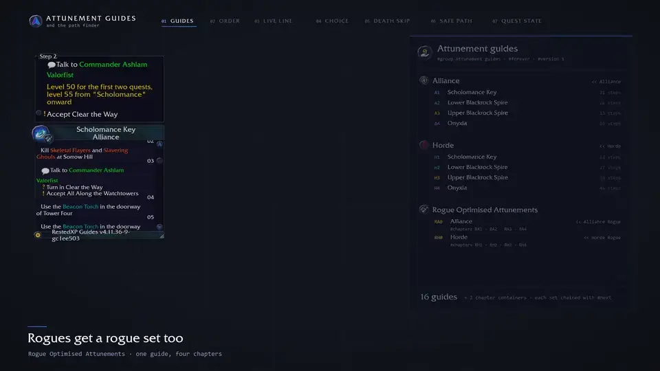
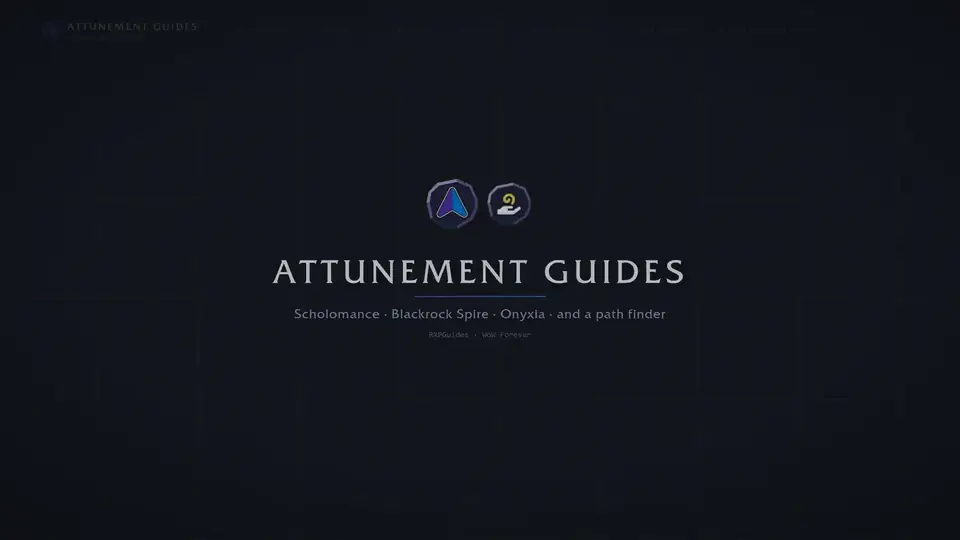
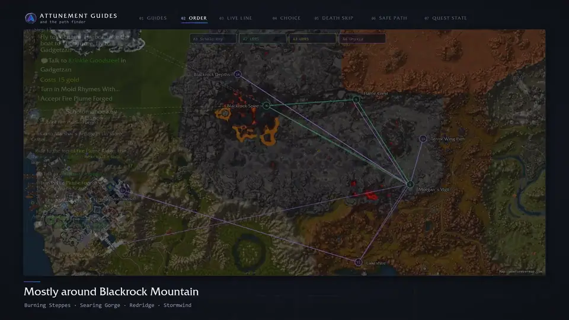
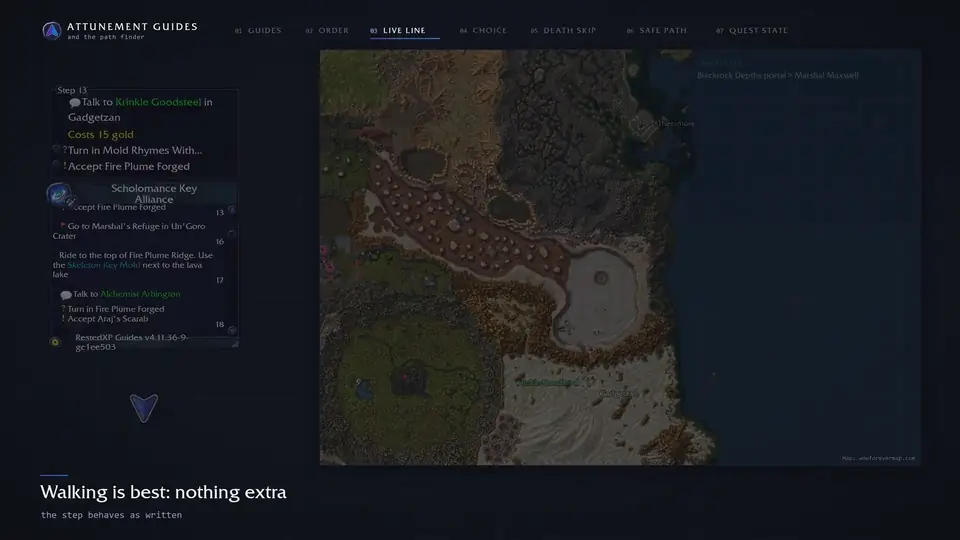
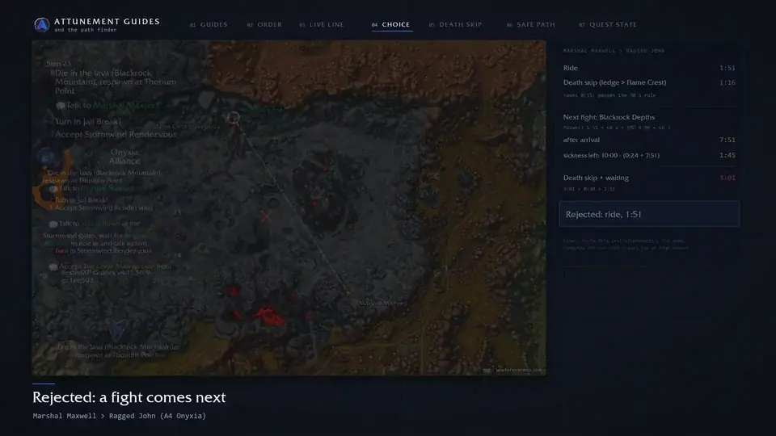
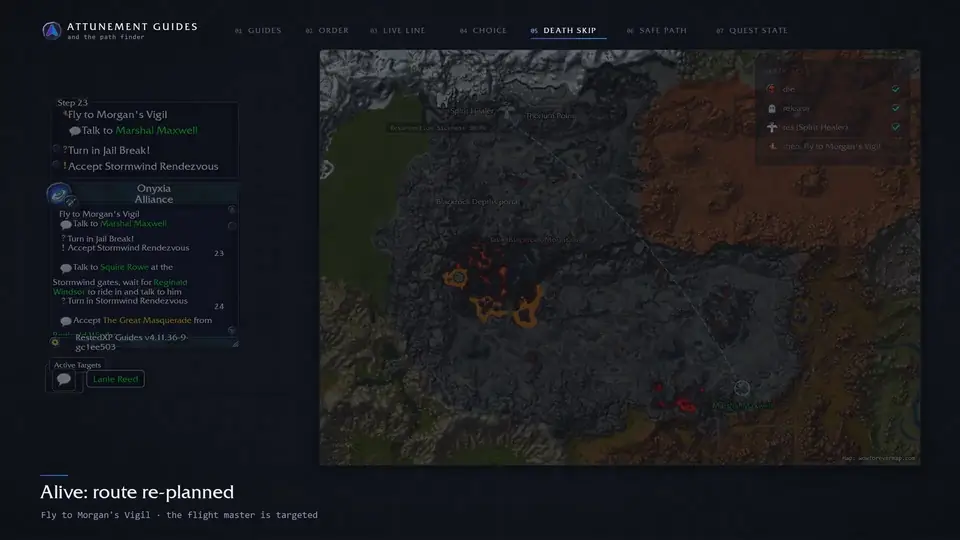
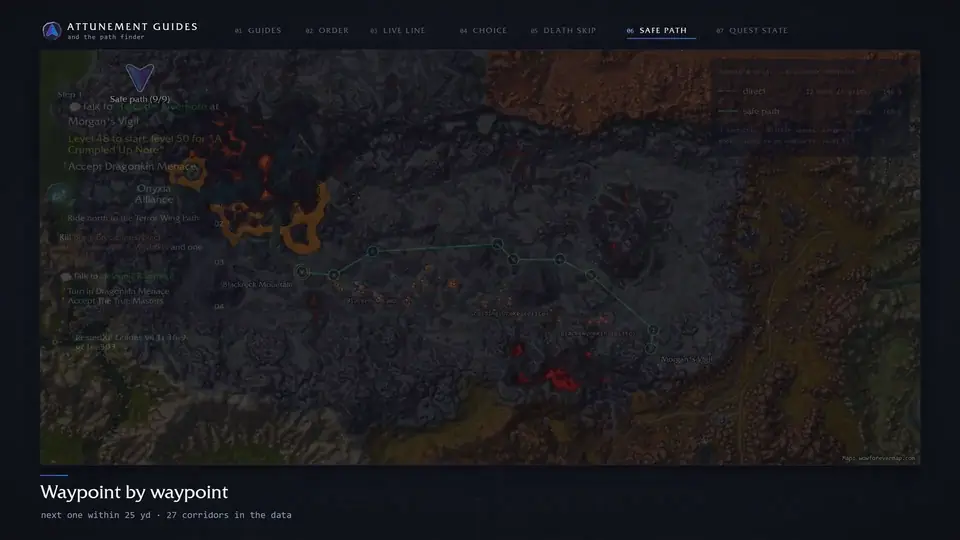

# Attunement guides and adaptive route engine (`AttuneRoute.lua`, `AttuneRouteData.lua`)

<!-- explained-head -->
<a href="videos/attunement-guides-explained.mp4"></a>

[Watch: Attunement guides and path finder, explained (75 s)](videos/attunement-guides-explained.mp4) · [Back to the overview](README.md)

Technical design notes for the RestedXP team. Describes the contributor feature as it is in
`` (commit "Add attunement guides with adaptive routing and death skips (WoW
Forever)"). The code is the reference; line numbers are given for orientation.

## 1. Problem

Attunement chains (Scholomance key, Blackrock Spire, Onyxia) cross both continents, and players
start them from wherever they are, often with part of the chain already done. A fixed `.goto` arrow
does not know about the player's flight paths, hearthstone or a death skip that would save minutes.
It also keeps pointing at places the player no longer needs to visit.

## 2. User-facing behaviour

### 2.1 Guides


*The step order: four chained guides, key steps, rogue variant, the route on the map* · [full-quality clip (MP4)](videos/attune-02-order.mp4)


 Alliance / Horde / Rogue Optimised" width="100%">

*The guide list: Attunement guides > Alliance / Horde / Rogue Optimised* · [full-quality clip (MP4)](videos/attune-01-list.mp4)


Guide list > **Attunement guides** (`#group Attunement guides`, `#forever`, `#version 1`):

| Subgroup | Filter | Guides |
|---|---|---|
| `Alliance` | `<< Alliance` | `A1 Scholomance Key`, `A2 Lower Blackrock Spire`, `A3 Upper Blackrock Spire`, `A4 Onyxia` |
| `Horde` | `<< Horde` | `H1` to `H4`, same four attunements |
| `Rogue Optimised Attunements` | `<< Alliance Rogue` | container `RA0 Alliance` with `#chapters RA1 ...;RA2 ...;RA3 ...;RA4 ...` |
| `Rogue Optimised Attunements` | `<< Horde Rogue` | container `RH0 Horde` with `#chapters RH1 ...;RH4 ...` |

That makes 16 content guides plus 2 chapter containers. Rogue chapters are `#chapter` + `#internal`
and have no `#subgroup`, so they appear only under their container. Each set is chained with `#next`
(1 to 2 to 3 to 4). The rogue variants follow the same route with stealth and vanish instructions where
the normal guide says to clear or bring a group. Rogues also see the faction guides.

Each file starts with the usual `if L and RXP.enabledLocale[L] then return end`. There is no
translated copy under `lang/` yet, so on locales with translated RXP guides these guides do not load.

### 2.2 What changes in a step



*The .bestroute line updating leg by leg, arrow and targeting following* · [full-quality clip (MP4)](videos/attune-03-bestroute.mp4)


Steps tagged `.bestroute` show one extra line, which updates as the player moves, and the arrow
follows the current leg of that route. Examples of the line:

- `Fly to Thorium Point, take the boat to Menethil Harbor` (up to 3 legs summarised);
- `Hearth to Kargath`;
- `Get the Flame Crest flight path`;
- `Die in the lava (Blackrock Mountain), respawn at Thorium Point`, then `Release your spirit`, then
  `Talk to the Spirit Healer (Thorium Point)`;
- `Ride: follow the arrow (safe path)` when only safe waypoints are left.

The arrow title shows the leg (`Safe path (3/8)` for corridor waypoints). The step's other arrow
elements are hidden while a route is active, and the RXP targeting frame gets the flight master or the
Spirit Healer to target. If walking is best and no corridor applies, nothing extra is shown and the
step behaves as authored.

Steps tagged `.safepath <id>` replace the arrow with the waypoints of a safe corridor (section 4.6).
In attunement guides, a step whose quest elements are all done is no longer held by its `.goto`
(section 4.7). There is no slash command or option. `addon.attuneRoute.Explain()` returns a debug
string for the last computation.

## 3. Step tags

All three are registered in `addon.functions` (`AttuneRoute.lua:1222-1262`) and parsed like any RXP tag.

| Tag | Parse result | Runtime |
|---|---|---|
| `.bestroute` | `{ textOnly, hidePin, attuneRoute = true }` | When the step is active: `Register(el)`, mode `route`. |
| `.combat` | `{ textOnly, combatMarker = true }` | No-op. Marks a fight for the death-skip look-ahead. Defined only if `functions.combat` does not exist. |
| `.safepath <id>` [`>>text`] | `{ textOnly, hidePin, attuneRoute, safepath, corridor = id, text }` | When active: `Register(el)`, mode `safepath`. An unknown id raises `addon.error` at parse time. |

Usage in the four files: 122 `.bestroute`, 68 `.combat`, 39 `.safepath`. The guides also use the
existing `.deathskip` (15) for authored death skips, plus `.isOnQuest`, `.isQuestComplete`, `.mob`,
`.collect` and `.xp` as usual.

## 4. How it works

### 4.1 Coordinates and travel times

World points are `{ wx, wy, inst, uiMap? }` in the HereBeDragons-2.0 convention (`wx` = 2nd value of
`UnitPosition`, `wy` = 1st, `inst` = continent: 0 Eastern Kingdoms, 1 Kalimdor; continent maps 1415 and
1414). Distances are Euclidean on the same `inst`, else `INF = 1e7`.

- `WalkTime(a, b) = dist * 1.25 / speed`. The speed is 14 yd/s with a 100 % mount spell known
  (33391, 34090, 34091, 90265), 11.2 with 33388 or at level 40+, else 7. Values come from
  `addon.travel.config` when present.
- `TimeBetween(a, b)`: best time using flights, hearthstone and transports, from `addon.travel`
  (`Travel.lua`, see `TRAVEL-PLANNER.md`). `Travel.lua` only routes from the player, so `WithPlayerAt`
  swaps `HBD.GetPlayerWorldPosition` for a function returning `a`, calls
  `travel.WorldTimeFromPlayer`, and restores the original synchronously. Results are cached for 120 s,
  keyed by both points rounded to 10 yd, hearthstone readiness (item 6948 cooldown) and
  `GetBindLocation()`. The cache is flushed above 300 entries.
- `PlanTo(target)`: `travel.Plan({ { id = "attuneroute", uiMap, x, y, duration = 0 } })`. It returns the
  travel entries (`kind` = `fly`/`fp`/`hearth`/`boat`/`zeppelin`/`tram`, with `board`, `to`, `fpId`,
  `lines`, `text`) and `travel.last.cost`. `travel.last` is saved and restored around the call.

### 4.2 Step target

`StepTarget(step)`: the first `goto`/`groundgoto`/`flygoto` element with a radius > 0 that is not
`textOnly`, else the last one. Its instance is resolved with `HBD:GetWorldCoordinatesFromZone` when
the element has none.

### 4.3 Route choice (`ComputeRoute`, `AttuneRoute.lua:657`)



*Candidates compared, the three death-skip rules, a rejected death skip* · [full-quality clip (MP4)](videos/attune-04-choice.mp4)


1. Within `max(radius, 40)` yd of the target: kind `here`, nothing shown.
2. `walk = WalkTime(player, target)`.
3. `entries, planCost = PlanTo(target)`. If the entries contain anything other than `fp` and
   `planCost + 15 < walk`, take `travel` and build legs from the entries. Otherwise keep `walk`, with
   `cost = min(walk, planCost)`.
4. Death option (4.4) against that cost; it replaces the best route if chosen.
5. Still `walk`: if a corridor applies (4.6), kind `safe` with its waypoints as legs.

Legs (`BuildLegs`): for each entry, safe-corridor waypoints from the current point to `board` (if a
corridor applies), then the entry leg. Hearth legs need no walk. After the last entry, corridor
waypoints to the target.

### 4.4 Death skips (`DeathOption`, `AttuneRoute.lua:614`)



*A death skip leg by leg: die, release, Spirit Healer, travel on* · [full-quality clip (MP4)](videos/attune-05-deathskip.mp4)


Hard exclusions, `DeathForbidden()`: hardcore (profile setting, guide flag or
`C_GameRules.IsHardcoreActive`), already dead or ghost, Resurrection Sickness active. Sickness means
aura 15007, or a spirit-healer resurrection seen by the engine less than 600 s ago.

Candidates: `deathSpots[faction]` on the player's continent, within 2500 yd, with a graveyard. For
each spot `s`:

```
tS   = 0 if within 30 yd, else TimeFromPlayer(s)       -- reach the spot
tG   = TimeBetween(s.gy, target)                        -- graveyard to target
cost = tS + s.ttd + 10 (release) + 30 (spirit healer) + tG
if cost + 30 <= best:                                   -- must save at least 30 s
    tc   = Lookahead(step)                              -- target to next fight, computed once
    wait = max(0, 600 - (tG + tc))                      -- sickness left when the fight starts
    eff  = cost + wait
    keep the spot with the lowest eff, if eff + 30 <= best
```

This is the "never right before a fight" rule. The 10-minute sickness must expire before the next
expected fight, so any shortfall is added as waiting time. A death followed closely by a fight costs
up to 600 s extra and loses to the normal route.

`Lookahead` (`AttuneRoute.lua:547`) returns 0 if the current step is a combat step. Otherwise it walks
the following steps that are not completed, not skipped (`RXPCData.stepSkip`) and that pass
`addon.stepLogic.HardcoreCheck`. For each one it adds the travel time between step targets
(`TimeBetween`, else `WalkTime`; unknown counts as 0, the conservative choice) plus 60 s per non-combat
step. It returns at the first combat step, once 600 s is reached, or after 30 steps (`INF`). At the end
of the guide it returns the accumulated time if `guide.next` is set (the next guide may start with a
fight), else `INF`. A combat step has `.combat`, `.mob` or `.complete` (`.complete` elements with
`flags % 2 == 1` excluded).

Death legs: travel legs to the spot (`PlanTo` if more than 30 yd away), then `die`, `release` and
`res` (Spirit Healer at `s.gy`).

### 4.5 Following the route (`Progress`, `UpdateRoute`)

A 0.5 s `OnUpdate` tick runs only while elements are registered. Leg advancement:

| Leg | Advances when |
|---|---|
| `safe` | within 25 yd of any of the next 4 safe waypoints |
| `fly` | `UnitOnTaxi` went true then false (re-plan as `landing`), or within 200 yd of `to` |
| `boat`/`zeppelin`/`tram` | within 300 yd of `to` (re-plan `landing`); within 35 yd of the dock marks `boarded` |
| `hearth` | within 300 yd of `to` (re-plan `landing`) |
| `fp` | `RXPCData.flightPaths[fpId]` known, or within 10 yd |
| `die` | `UnitIsDeadOrGhost` |
| `release` | `UnitIsGhost`. Alive without being a ghost (soulstone, player res) ends the route (`res`) |
| `res` | alive again: records `lastSpiritRes`, re-plan `res` |

Off-plan: more than 250 yd from the segment previous leg end to current leg point, or on another
continent without having boarded, marks `offplan`.

Recompute rules. Skipped while dead, on a taxi, in combat, without a position, during
`release`/`res`, or while boarded. A strong reason (`first`, `zone`, `res`, `landing`, `offplan`)
recomputes if at least 1 s has passed. Otherwise the route is recomputed periodically: at least 5 s
after the last computation and either 60 yd moved or 30 s elapsed. A periodic result replaces the
current route only if its leg signature differs and it is at least 20 s faster than the remaining
cost. If a computation takes more than 30 ms of CPU (`debugprofilestop`), the intervals are tripled.
Events: `ZONE_CHANGED_NEW_AREA` and `PLAYER_ENTERING_WORLD` mark `zone`; `PLAYER_ALIVE` and
`PLAYER_UNGHOST` mark `res`.

Automation during legs (`OnEvent`, `AttuneRoute.lua:1153`):

- `fly` leg, `GOSSIP_SHOW` or `TAXIMAP_OPENED`, step without its own `.fly`: calls RXP's
  `addon.functions.fly` with a proxy element (`location` = escaped upper-case node name). This reuses
  the taxi gossip and node selection, never its completion.
- `res` leg as a ghost, step without `.deathskip`: selects the healer gossip
  (`addon.SelectGossipType("healer")`). On `CONFIRM_XP_LOSS` or the SpiritHealer interaction it
  confirms the resurrection (`C_PlayerInteractionManager.ConfirmationInteraction`, else `AcceptXPLoss`).

### 4.6 Safe corridors



*Safe path: direct route through mobs vs corridor waypoints* · [full-quality clip (MP4)](videos/attune-06-safepath.mp4)


`corridors[id][faction] = { name, inst, exposures, safeExposures, wps = { {wx, wy, uiMap}, ... } }`.
The id is `<from key>-<to key>`. When a faction has no entry, the first available one is used for
`.safepath`.

- Explicit (`.safepath <id>`, `UpdateSafepath`): project the player onto the polyline and start at the
  next waypoint (waypoint 1 if more than 300 yd away). Advance within 25 yd of any of the next 4.
  Zone change or resurrection re-projects.
- Automatic (`CorridorWalk`): applies only to corridors where `exposures > safeExposures`, i.e. the
  safe path meets fewer dangerous mobs than the direct path, on the same continent as both ends.
  Both directions are tried. The start must be within 200 yd of the polyline, the end within 400 yd of
  its last waypoint and closer than the start is. The remainder must be at least 100 yd. The lowest
  `dA + dB` wins.

### 4.7 Quest-state adaptation (`QuestAdapt`, `AttuneRoute.lua:1081`)



*A step already done is released; drifting off re-plans the route* · [full-quality clip (MP4)](videos/attune-07-adapt.mp4)


Every 1 s, only when `currentGuide.group` (minus a leading `*`/`+`) is `Attunement guides`. For each
step in `addon.RXPFrame.activeSteps` that is active and not completed: if it has at least one quest
element (`accept`, `turnin`, `complete`, `collect`, `acceptmultiple`, `turninmultiple`), all of them are
completed or skipped, and every other non-`goto`, non-`textOnly` element is done, then
`addon.SetElementComplete(goto, true)` is applied to its remaining `goto` elements. Together with the
authored `.isOnQuest` / `.isQuestComplete` conditions, a guide loaded mid-chain skips what the quest
log already shows as done.

### 4.8 What the engine writes on RXP objects (`Refresh`, `Cleanup`)

On the `.bestroute` / `.safepath` element: `wx`, `wy`, `instance`, `zone`, `x`, `y` (current leg point),
`arrow`, `title`, `icon` (`addon.icons` `fly`/`fp`/`hs`/`deathskip`/`goto`), `text` (route mode),
`targets` (`{ "Spirit Healer" }` localised through `addon.locale.Get`, or `"Name::npcId"` of the flight
master from `addon.travel.flightMasters` / `addon.taxiPos`). On other arrow elements of the step:
`hidden = true`. On the step during ghost legs: `ignorecorpse = true`, so `map.lua` stops pointing at
the corpse. Then `addon.UpdateStepText`, `addon.UpdateMap(true)` and, out of combat,
`addon.targeting:UpdateUnitList()`. When the step leaves `active` or the guide changes, `Cleanup`
restores all of these.

## 5. Data (`AttuneRouteData.lua`, generated)

`addon.attuneRouteData = { version = 1, deathSpots = {...}, corridors = {...} }`, generated by
`ext/attunements/scripts/gen_attuneroute_data.py` from `deathskips.json` and `danger.json`. The
generator and its sources are outside the addon repo and not in the branch.

- `deathSpots[faction]`: `{ id, wx, wy, inst, uiMap, method = fall|lava|mobs|drown, ttd, label, killer?,
  gy = { name, wx, wy, inst, uiMap }, evidence, legs }`. There are 5 Alliance and 8 Horde spots. The
  engine does not read `evidence` (number of observed deaths) or `legs` (guide legs the spot was mined
  for). The spots come from the contributor's Deathskip addon data (real deaths mapped to the graveyard
  used).
- `corridors`: 27 ids, waypoints per faction, as described in 4.6.

## 6. Integration points, SavedVariables, load order

| Where | Change |
|---|---|
| `addon.functions` | new `bestroute`, `safepath`, and `combat` (only if absent) |
| `Guides/GuideList-forever.xml` | 4 `<Script>` lines appended at the end of the file (Rogue-Alliance, Alliance, Rogue-Horde, Horde), so existing guide indices do not shift |
| `RXPGuides.toc` | `AttuneRouteData.lua`, `AttuneRoute.lua` appended after `Travel.lua` |
| Read | `addon.currentGuide`, `RXPFrame.activeSteps`, `RXPCData.stepSkip`, `RXPCData.flightPaths`, `addon.stepLogic.HardcoreCheck`, `addon.settings.profile.hardcore`, `addon.taxiPos`, `addon.icons`, `addon.locale` |
| Called | `addon.SetElementComplete`, `addon.UpdateStepText`, `addon.UpdateMap`, `addon.targeting:UpdateUnitList`, `addon.functions.fly`, `addon.SelectGossipType` |
| Depends on | `addon.travel` (`Travel.lua`, `TravelFlightMasters.lua`), HereBeDragons-2.0, `addon.groupL` |

No SavedVariables. `AR.lastSpiritRes` is in memory only, so after a `/reload` the aura check is the
only sickness guard. Load order: `GroupLocale.lua`, then `TravelFlightMasters.lua`, then `Travel.lua`,
then `AttuneRouteData.lua`, then `AttuneRoute.lua`. The engine reads `addon.travel` and
`addon.attuneRouteData` lazily, so a missing file only disables features. Strings are registered
inline with `addon.AddGroupTranslations` (24 keys, 9 locales).

## 7. Limitations, Forever specifics, test status

- WoW Forever only by content (`#forever`, Forever uiMap ids, Forever death spots). The engine itself
  is client-agnostic and loads on every client served by `RXPGuides.toc`, but stays idle without the
  tags.
- Taint: no Blizzard table is written. `HBD.GetPlayerWorldPosition` is replaced for the duration of
  one synchronous `pcall`. `ConfirmationInteraction` and `AcceptXPLoss` run from event handlers.
- Spirit-healer resurrection is auto-confirmed on `res` legs: Resurrection Sickness and durability loss
  happen without a click. The player chose the death skip by dying, but this is a behaviour to decide on.
- Travel times are estimates (fixed overheads, straight-line walking x 1.25). There is no pathing
  around terrain except the corridors.
- `TimeBetween` calls Travel's Dijkstra for every candidate spot and look-ahead step. The 120 s cache and
  the 30 ms throttle bound the cost. With many spots on one continent, the first computation can be
  slow on weak CPUs.
- Only the first `.bestroute` target of a step is routed. Multi-target steps rely on the authored
  `.goto` list after arrival.
- Test status (contributor's README): the guides load and route in game on WoW Forever. Not every
  guide has been run end to end. Other clients and the V2 guide window are not tested.

## 8. File map

| File | Lines | Content |
|---|---|---|
| `AttuneRoute.lua` | 1521 | Config 31, helpers 102-261, travel times 266-343, corridors 352-429, legs 435-493, step analysis and look-ahead 498-579, death skips 584-652, `ComputeRoute` 657, text/arrow/targets 696-866, state and progress 871-1067, `QuestAdapt` 1081, driver 1115-1217, tags 1222-1262, `Explain` 1267, translations 1284-1521 |
| `AttuneRouteData.lua` | 343 | Generated death spots and corridors |
| `Guides/forever/Attunements-Alliance.lua` | 719 | A1-A4 (96 steps) |
| `Guides/forever/Attunements-Horde.lua` | 829 | H1-H4 (112 steps) |
| `Guides/forever/Attunements-Rogue-Alliance.lua` | 735 | RA0 container + RA1-RA4 (97 steps) |
| `Guides/forever/Attunements-Rogue-Horde.lua` | 772 | RH0 container + RH1-RH4 (104 steps) |
| `Guides/GuideList-forever.xml` | +4 | Registration, appended at the end |
| `RXPGuides.toc` | +2 | File entries |
| `GuideLoader.lua` | +8 / -1 | Fix, see Related fixes and notes |
| `Communications.lua` | not in branch | Workaround, local build only (see Related fixes and notes) |

## Related fixes and notes

### `GuideLoader.lua`: stale `RXPCData.guideDisabled` entries (part of the contribution)

`LoadGuide(guideData, n)` caches "this embedded guide is disabled for this character" as
`RXPCData.guideDisabled[n] = <content length>`, keyed by the position `n` of the guide in the
`embeddedGuides` queue. On the next load, a non-nil entry skipped the guide without parsing its
header. Inserting or moving a guide in a `GuideList` changes the guide each index points to, so a
guide could inherit the "disabled" flag of the one that used to sit at its index and silently vanish
from the menu.

Fix (+8 lines): if the cached value is a number different from `guideData.groupOrContent:len()`, the
entry is treated as stale, cleared, and the guide header is evaluated normally. A legacy `true` value
is left alone.

Review note: `addon.LoadEmbeddedGuides` already rebuilds the table when
`not guideDisabled[0] or guideDisabled[0] <= #embeddedGuides`. As written, this resets the cache on
almost every load (the count is usually unchanged), and each incremental `LoadEmbeddedGuides(1)` call
in hardcore mode resets it again. Stale entries therefore survive only when the queued-guide count
went down between two sessions of the same release, which is still possible. You may want to check
whether that condition was meant to be `~=`. Either way, the length guard is cheap and safe.

### `Communications.lua`: `ShareQuest` on WoW Forever (not part of the contribution)

`functions.lua` calls `addon.comms.grouping:ShareQuest(id)` when a guide `accept` element completes.
With the "Automatic quest sharing" option (`shareQuests`, off by default, enabled by the "enable all
group features" preset in `SettingsPanel.lua`), this calls `QuestLogPushQuest`. On WoW Forever that
function is protected: called outside a hardware event it raises `ADDON_ACTION_BLOCKED`, and the
blocked-action popup appears on every quest accept while grouped.

The contributor's local build works around it with an unconditional `do return end` at the top of
`ShareQuest`. That disables the feature everywhere, so it is not proposed. Options for you: skip the
auto-push on Forever, or turn it into an explicit click (button or menu entry) that calls
`QuestLogPushQuest` from the click handler.
