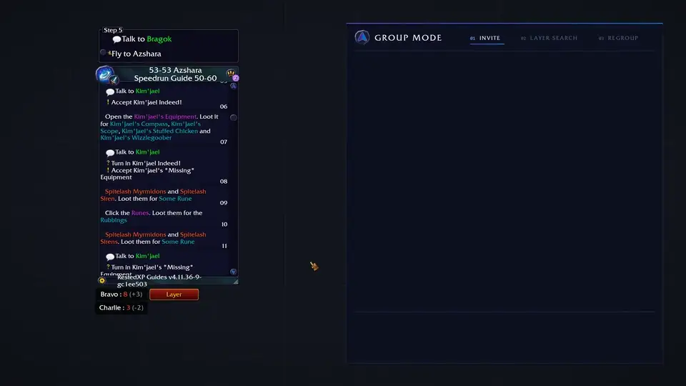
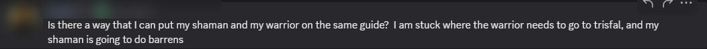
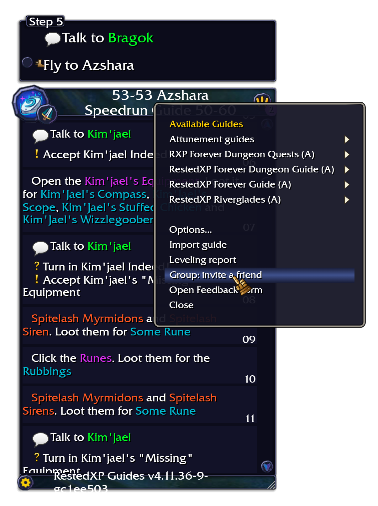
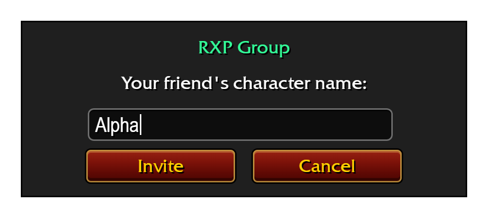
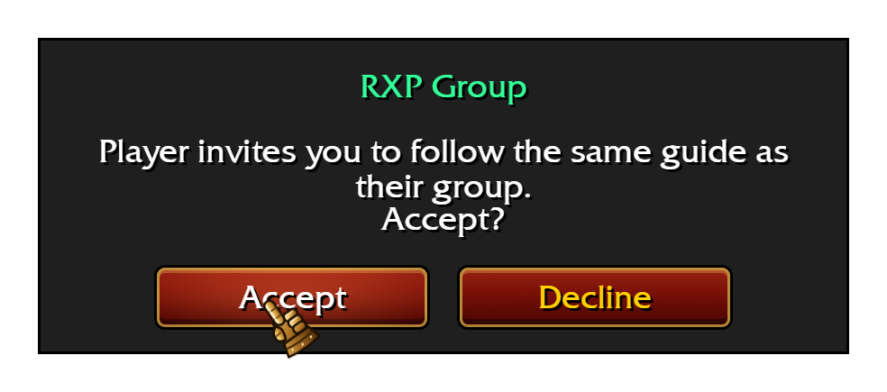
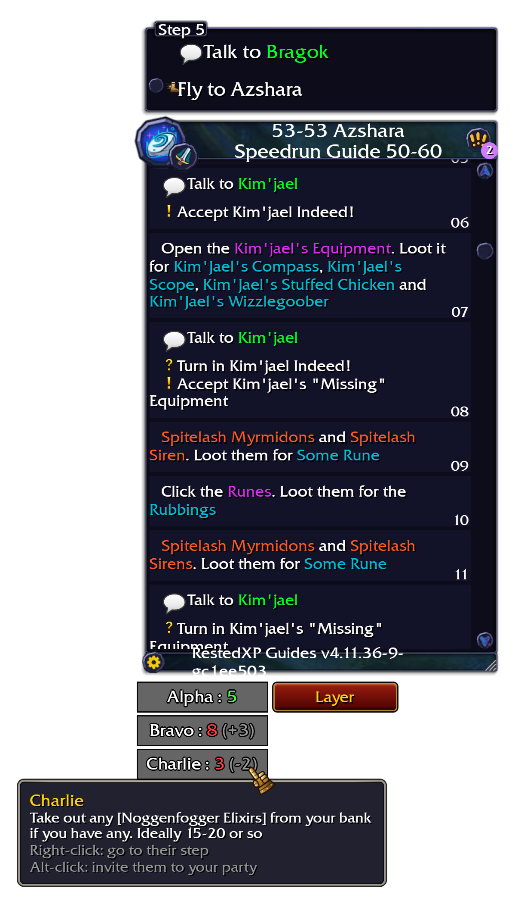
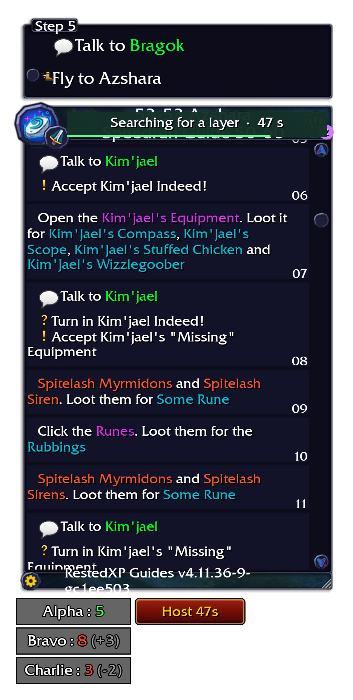
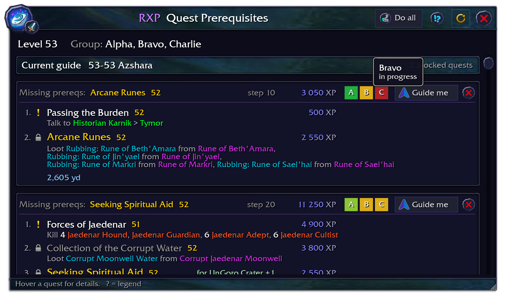
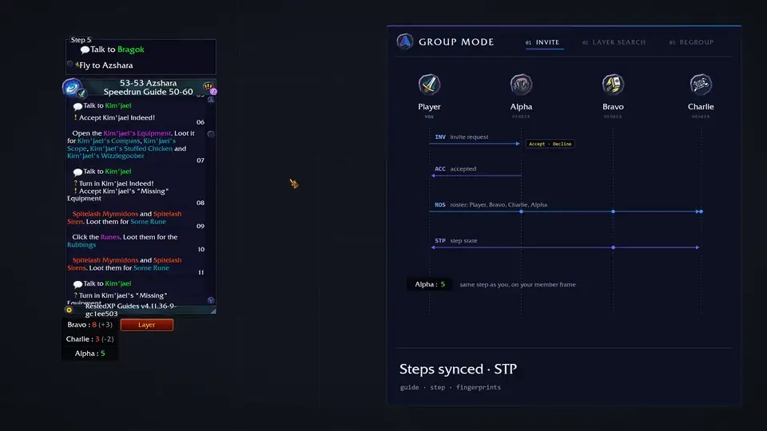
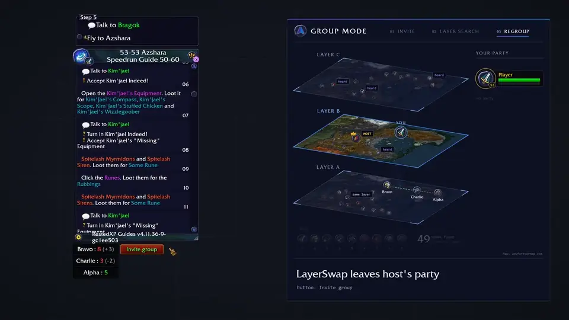

# Group mode (`Duo.lua`, `GroupLocale.lua`, `GroupTranslations.lua`)

<!-- explained-head -->
<a href="videos/group-mode-explained.mp4"></a>

[Watch: Group mode and one-click layer search, explained (37 s)](videos/group-mode-explained.mp4) · [Back to the overview](README.md)

Technical design notes for the RestedXP team. Describes the contributor feature as it is in
`Duo.lua` (commit "Add group mode (up to 5 players, roster sync, one-click
layer search)" and "Add translation layer for the community features"). The code is the reference;
line numbers are given for orientation.

## 1. Problem

> **The problem, as players put it** (RestedXP Discord, names hidden):
>
> 
>
> 


Friends levelling together on the same guide lose each other: one is three steps ahead, another is
on a different guide, and nobody knows until they ask in chat. On WoW Forever, layering also splits
groups, and moving everybody to the same layer means leaving the party, finding a host and
re-inviting everyone by hand.

## 2. User-facing behaviour

All players must run this build of RXPGuides; there is no fallback to standard RXP comms.

The images in this document are HTML reproductions rendered at 3x from the layout code of `Duo.lua`
(sizes, anchors, colours, fonts, strings) on top of the RXP guide window. WoW's own widgets (menu,
buttons, edit box, tooltip) are redrawn in their standard style. Player names are placeholders.

### 2.1 Slash commands

`/rxpgroup`, `/groupe`, `/rxpgroupe` and `/duo` are aliases (`SLASH_RXPDUO1..4`, `Duo.lua:1130`).
The first word is the subcommand; English and French words are both accepted (`Slash`, `Duo.lua:1070`).

| Subcommand | Effect |
|---|---|
| `add <Name>` / `ajouter` / `inviter` | Send a group request. Without a name: opens the name input dialog. |
| `remove <Name>` / `retirer` / `kick` | Remove one member (sends `BYE` to that member only). |
| `leave` / `quitter` / `stop` | Leave the group (sends `BYE` to every member, clears the roster). |
| `layer` / `swap` | Start the layer search (section 4.6). `layer stop` / `layer annuler` cancels it. |
| `regroup` / `regrouper` | Re-invite the group after a layer change (`duo:Reinvite`). |
| `hide` / `cacher`, `show` / `montrer` | Hide or show the member frame (`RXPDuoDB.hidden`). |
| `reset` | Clear the saved frame position, re-anchor under the guide window. |
| `debug` | Print my guide id, step, step ids and fingerprints, and how each member maps into my guide. |
| (none or unknown) | Print the roster with `online` / `offline` / `waiting` and the command list. |

### 2.2 Menu entry

`RXPFrame:GenerateMenuTable` (guide window right-click menu) gets one entry from `duo:MenuEntry()`
(`Duo.lua:626`):

- 0 members: "Group: invite a friend"; 1 to 3 members: "Group (N/5): invite a friend" (N includes
  me). Both open the name input dialog.
- 4 members (group full): "Group: leave the group", which calls `duo:Remove()`.



*Right-click on the guide banner, no group yet: the entry sits before "Open Feedback Form" and has no submenu.*

### 2.3 Dialogs

A single custom frame `RXPDuoDialog` (`GetDialog` / `ShowDialog`, `Duo.lua:520-597`) is reused for
every prompt: name input ("Invite" / "Cancel"), incoming request ("Accept" / "Decline", closes after
60 s), and the layer regroup prompt ("Join" / "No", closes after 60 s). A token makes sure a timeout
only closes the dialog it was set for. `StaticPopupDialogs` / `StaticPopup_Show` are deliberately not
used (see 6.2).



*Name input, opened by the menu entry or `/rxpgroup add`.*



*The same frame on the invited player's side after `INV`: Accept sends `ACC`, Decline sends `DEC`.*

### 2.4 Member frame

`RXPDuoFrame` shows one row per member, below the guide window by default (`TOPLEFT` of the frame
at `BOTTOMLEFT` of `addon.RXPFrame`, -4 px), draggable, position saved in `RXPDuoDB.pos`. Row text
(`MemberText`, `Duo.lua:379`):

| Text | Meaning |
|---|---|
| `Name : 42` green | Member is on my guide, same step as me. |
| `Name : 45 (+3)` red + grey offset | On my guide, mapped to step 45 of my guide (3 ahead). |
| `Name : 12` grey | Same guide id but the step could not be mapped; their raw index is shown. |
| `Name : other guide` red | Different guide. |
| `Name : —` grey | No state received yet, or they have no guide loaded. |
| `Name : offline` grey | A whisper to them failed with "player not found". |

Tooltip: member name, the cleaned text of their current step, and two hints. Right-click a row:
`addon.SetStep(pos)` moves my guide to their mapped step. Alt-click a row: sends them a `GRP`
invitation (`duo:InviteMember`).

A "Layer" button sits right of the first row. Its label follows the layer state (section 4.6):
`Layer`, `Search` (green), `Host 37s` (countdown), `Invite group` (green), `Invited...`. Left-click:
cancel while `asking`/`regroup`, regroup when `done`/`joined`, otherwise start the search.
Right-click: always cancel.



*The player is on step 5: Alpha on the same step, Bravo 3 ahead, Charlie 2 behind; row tooltip on Charlie.*

### 2.5 Pulsing banner

While the layer search is in the `asking` phase, an overlay frame is drawn over
`addon.RXPFrame.GuideName` (`Pulse`, `Duo.lua:812`): an opaque strip in the theme background colour
(`addon.colors.background`), a green glow with a looping alpha animation (0.25 to 1, 0.9 s, bounce),
the text "Searching for a layer · N s" and a 2 px bar whose width shrinks with the remaining time of
the 60 s timeout. It is refreshed every second by the layer ticker and hidden on any other phase.



*Phase `asking`, 47 s left: the button shows "Host 47s". The strip is 22 px high (GuideName 35 - 10, capped),
so a two-line guide name at guide font size 12 still shows above and below it.*

## 3. Names on WoW Forever

Forever characters have a first name and a surname. The code canonicalises every name to
`"First Last"`:

- `Short(name)` (`Duo.lua:28`): replaces `-` with a space, collapses whitespace, trims. Needed because
  the sender of an addon message arrives as `"First-Last"` (the surname is placed in the realm slot).
- `Same(a, b)`: case-insensitive equality after `Short`. `MemberKey(name)`: lower-cased `Short`,
  used as key of all runtime tables.
- `MyName()` (`Duo.lua:41`): `UnitName("player")` returns `first, surname`; they are joined unless
  the surname is already contained in the first value.
- `UnitFull(unit)` (`Duo.lua:49`): same join for `party1..4`, used to test party membership.

Whispers are sent to the `"First Last"` form. Section 6.1 explains why this is Forever-only.

## 4. How it works

### 4.1 Transport

- Prefix `RXPDuo`, protocol version `PROTO = "3"`. Every message is a tab-separated list:
  `kind \t proto \t field3 \t ...`, parsed with `Split` (empty fields kept).
- Sent per member on the `WHISPER` channel (`Send`, `Duo.lua:120`), through AceComm-3.0 when
  available (RXP bundles it; the message is truncated to 900 bytes, UTF-8 safe, `Truncate`), else
  `C_ChatInfo.SendAddonMessage` / `SendAddonMessage` truncated to 250 bytes. All calls are `pcall`-wrapped.
- There is no party/raid broadcast: `SendAll` loops over the roster. Members do not need to be in
  the same party, or even the same zone.
- Received with `duo:RegisterComm` (AceComm) or `CHAT_MSG_ADDON` as fallback; the prefix is
  registered at `PLAYER_LOGIN` when AceComm is absent.
- Messages from senders not in the roster are ignored, except `INV` (from anyone) and `ACC` / `DEC`
  (from a pending invitee).

### 4.2 Message types


*Invite flow and the hidden addon messages (INV, ACC, ROS, STP)* · [full-quality clip (MP4)](videos/group-01-invite.mp4)


| Kind | Fields after `kind, proto` | Sent when | Receiver |
|---|---|---|---|
| `INV` | none | `duo:Invite(name)`; the name goes into `pending` | Already a member: reply `ACC` + own `STP`. Else show the Accept/Decline dialog. Accept: `ACC` (or `DEC` if my group is full), add the sender, send `STP`. Decline: `DEC`. |
| `ACC` | none | invitee accepted | If pending: add the sender, `SendRoster()`, send `STP`. If already a member: mark online, send `STP`. |
| `DEC` | none | invitee declined / full | If pending: clear it, print "declined". |
| `ROS` | `f3` = comma list of names, sender first | after a new member is added | From a member only: add every name not yet known (and not me), respecting the 5-player cap. |
| `BYE` | none | remove / leave | Drop the sender from my roster. |
| `HI` | none | 6 s after `PLAYER_LOGIN` | Mark the sender online, reply with my `STP`. |
| `STP` | see 4.3 | step change or heartbeat | Store the state, mark online; if they were not known online, reply with my `STP`. |
| `GRP` (legacy alias `LSW`) | none | regroup after a layer change, or Alt-click | Ignored if the sender is already in my party. Else Join/No dialog; Join: remember `follow = sender` for 30 s, leave my current party if the sender is not in it, reply `GOK`. |
| `GOK` | none | member accepted `GRP` | After 1.2 s, `InviteUnit(sender)` unless they are already in my party. |
| other | module-defined | `duo.SendAll` / `duo.Send` | Dispatched to `handlers[kind]` if the sender is a member. |

Module API (`Duo.lua:135-140`): `duo.Members()` (copy of the roster), `duo.SendAll(kind, ...)`,
`duo.Send(name, kind, ...)`, `duo.On(kind, fn)` where `fn(fields, senderShortName)`, `duo.MyName`,
`duo.StepFingerprint`, `duo.ShowDialog`. The only user is `Prereq.lua`, which registers `PQQ` (query:
`f3` = comma list of quest ids, up to 70 per message) and `PQR` (reply/push: `f3` = `qid:s,...` with `s`
in `n` not taken, `l` in log, `c` complete, `t` turned in) to show members' quest states. These two are
part of the Quest Prerequisites feature (see `QUEST-PREREQUISITES.md`).



*One square per member on each Quest Prerequisites card, coloured from their `PQR` state of the blocked quest.*

### 4.3 Step state (`STP`)

`MyState()` (`Duo.lua:190`) builds, from `addon.currentGuide` and `RXPCData.currentStep`:

| Field | Content |
|---|---|
| `f3` guideId | `guide.group .. "\" .. guide.name` (empty if no guide) |
| `f4` guideName | `addon.GetGuideName(guide)` |
| `f5` index | current step index |
| `f6` duo | `tonumber(step.duo)`: optional `#duo N` step property used by the contributor's duo guide (not in this branch), else 0 |
| `f7`, `f8`, `f9` | `UnitLevel`, localised class name, class file (stored, not displayed yet) |
| `f10` ids | comma list of `stepId` of the current step and the next 5 |
| `f11` fps | semicolon list of fingerprints of the same 6 steps |
| `f12` text | cleaned text of the current step (textures, colours, links and newlines stripped), last so truncation only cuts it |

Proto `3` added `f11`. For an older proto the receiver reads `f11` as the text and leaves `fps` empty.

**Fingerprint** (`StepFingerprint`, `Duo.lua:174`): the first `accept`/`turnin`/`complete` element
with a quest id gives `a<id>`, `t<id>` or `c<id>.<objIndex>`; otherwise the first `goto` gives
`g<round wx>/<round wy>`. It is meant to be identical for every class on shared steps, so two
players of different classes on a class-conditional guide can still be matched.

**Sending** (`duo:SendStep`, `Duo.lua:223`): a 1.5 s ticker calls `SendStep(false)`. The key
`guideId:index:#text` is compared to the last one sent; unchanged and less than 30 s old means no
send. So a change goes out within 1.5 s and there is a 30 s heartbeat. A member marked offline gets
one try per 60 s. `force = true` (after `HI`, `ACC`, roster changes) bypasses both limits.

**Mapping a member into my guide** (`MemberPositionInMyGuide`, `Duo.lua:255`), only if `guideId`
matches mine:
1. Step ids: for each id in `f10`, in order, the first step of my guide with that `stepId` wins.
2. Fingerprints: for each fingerprint in `f11`, in order, the step of my guide with the same
   fingerprint closest to `index + offset` wins (`offset` grows by 1 per fingerprint).
3. `#duo` number: first step whose `step.duo >= ps.duo`, else the last step.
4. Otherwise unmapped (grey raw index).

### 4.4 Roster

- `RXPDuoDB.members` holds the other players (max 4, `MAX_OTHERS`), in the `"First Last"` form.
- Invite flow, A invites B: A adds B to `pending` and sends `INV`. B accepts and adds A. A receives
  `ACC`, adds B, sends `ROS` (A, B, C, D) to every member. B adds C and D. C and D add B. Nobody
  exchanges `INV`/`ACC` with B except A: being listed by an existing member is enough.
- If A has no answer after 15 s it prints "no answer" (the pending entry stays until `ACC`/`DEC`, or
  the offline filter clears it).
- Leaving sends `BYE` to all. Removing X sends `BYE` to X only: X drops me, the other members keep X.
- Online state: `online[k] = true` on any message from k; `false` when the `CHAT_MSG_SYSTEM` filter
  (`OfflineFilter`, `Duo.lua:1005`) sees `ERR_CHAT_PLAYER_NOT_FOUND_S` for a member's name. The filter
  also hides that system message. For a pending name it prints "not online" and clears the pending entry.

### 4.5 Saved data migration

`DB()` (`Duo.lua:56`) migrates `RXPDuoDB.partner` (the 2-player version) into `members[1]`. Once
(`cleaned2`), it keeps only names that contain a space, removing me and duplicates. That drops stale
single-word names saved by early builds.

### 4.6 One-click layer search (requires the LayerSwap addon)



*One-click layer search: /who scan, hidden whispers, host invite, layer change (time-lapse)* · [full-quality clip (MP4)](videos/group-02-layer-search.mp4)



*Regroup on the new layer: GRP, leave party, GOK, invite, auto-accept* · [full-quality clip (MP4)](videos/group-03-regroup.mp4)


Assumption in the code (from LayerSwap's behaviour on Forever): a player changes layer by joining
the party of a LayerSwap host on another layer. LayerSwap refuses to search while you are in a party,
and its search must start from a hardware click. Once the layer change is confirmed, LayerSwap leaves
the host's party. LayerSwap is driven only through `SlashCmdList["LAYERSWAP"]("swap" | "stop")`; it is
detected by the presence of that slash handler.

State `duo.layer.phase` (on the player who changes layer):

```
nil --click--> [in party] LeaveParty(); still in party -> leaving ; else -> asking + /ls swap
leaving --GROUP_LEFT--> ready --click--> asking + /ls swap
leaving|ready --120 s--> nil
asking --PARTY_INVITE_REQUEST from a non-member--> AcceptInvite(), host = inviter -> joined
asking --GROUP_JOINED--> joined
asking --60 s--> /ls stop -> done ("no host answered")
joined --GROUP_LEFT (LayerSwap left the host party)--> done ; if pendingRegroup -> regroup now
joined --40 s--> done ("host party not left")
done --click "Invite group"--> LSRegroup ; done --600 s--> nil
regroup --GROUP_ROSTER_UPDATE, all online members in my party--> nil ; regroup --60 s--> nil
any --right-click / `layer stop`--> /ls stop if asking|joined -> nil
```

`LSRegroup` (`Duo.lua:874`): while `joined`, it only sets `pendingRegroup`, because leaving the host
party early would cancel the layer change. If every online member is already in my party, it ends.
Otherwise it moves to `regroup`, leaves the current party if no member is in it (that is the host's
party), and sends `GRP` to each online member not in my party.

On each member: `GRP` opens the Join dialog. Join records `follow`, leaves their own party and sends
`GOK`. The changer receives `GOK` and invites them after 1.2 s. The member's `PARTY_INVITE_REQUEST`
from `follow` within 30 s is accepted automatically (`C_PartyInfo.AcceptInvite` or `AcceptGroup`). The
Blizzard invite popup is then hidden (`StaticPopup_Hide("PARTY_INVITE")`, `PARTY_INVITE_XREALM`,
`LFGInvitePopup`), immediately and again after 0 and 0.3 s.

A 1 s `C_Timer.NewTicker` (`Duo.lua:986`) drives the timeouts, the button label and the banner.

## 5. Integration points

| Where | Change |
|---|---|
| `GuideWindow.lua`, `RXPFrame:GenerateMenuTable` | +4 lines: `if addon.duo and addon.duo.MenuEntry then tinsert(menuList, addon.duo:MenuEntry()) end`, inserted before "Open Feedback Form". |
| `RXPGuides.toc` | `RXPDuoDB` added to `SavedVariablesPerCharacter`; `GroupLocale.lua`, `GroupTranslations.lua`, `Duo.lua` appended at the end of the file list. |
| Read-only uses | `addon.currentGuide`, `RXPCData.currentStep`, `step.stepId`, `step.elements`, `addon.GetGuideName`, `addon.SetStep`, `addon.RXPFrame` (anchor), `addon.RXPFrame.GuideName` (banner host), `addon.colors.background`. |
| Exposed | `addon.duo` (API in 4.2), used by `Prereq.lua`. |

No existing RXP function is replaced or hooked; Duo does not use RXP's `RXPGComms` prefix or
`addon.comms`.

### Translation layer

`GroupLocale.lua` (19 lines) creates `addon.groupL`, a table whose `__index` returns the key, so
English keys are the fallback. `addon.AddGroupTranslations({ frFR = {...}, deDE = {...} })` copies only
the current locale's non-empty strings into it with `rawset`. `esMX` maps to `esES` and `enGB` to
`enUS`. It is a separate table from RXP's `addon.locale` and from `addon.L` (read by `QuestLog.lua`).
`GroupTranslations.lua` (734 lines) is generated by `tools/make_group_translations.py` (outside the
repo). It covers frFR, deDE, esES, itIT, ptBR, ruRU, koKR, zhCN and zhTW for the Duo and Travel strings.
`AttuneRoute.lua` and `Prereq.lua` register their own strings the same way. Keys are `string.format`
patterns: translations must keep the same placeholders in the same order.

## 6. SavedVariables, load order, limitations

### 6.1 SavedVariables and load order

`RXPDuoDB` (per character): `members` (array of `"First Last"`), `pending` (`lowername -> true`),
`hidden`, `pos` (`{point, relPoint, x, y}`), `cleaned2`, legacy `partner` (migrated). Load order:
`GroupLocale.lua`, then `GroupTranslations.lua`, then `Duo.lua` (it captures `addon.groupL` at load),
then `Prereq.lua` (it calls `addon.duo.On` at load). Runtime state (`states`, `online`, `lastTry`,
`layer`) is not saved.

### 6.2 WoW Forever specifics

- Interface 16001 on the modern (Midnight) API. The code prefers `C_PartyInfo.InviteUnit`,
  `LeaveParty` and `AcceptInvite`, and `C_ChatInfo.SendAddonMessage`. It falls back to
  `ChatFrameUtil.AddMessageEventFilter` when `ChatFrame_AddMessageEventFilter` is missing, and to the
  old globals elsewhere.
- Taint: on this client, writing into `StaticPopupDialogs` from addon code tainted the UI (Escape,
  action bars), so all prompts use the custom `RXPDuoDialog`. The code still calls `StaticPopup_Hide`
  to close the invite popup after auto-accepting; worth checking for taint on your side.
- Name handling (section 3) assumes Forever names. On a realm-based client, `"Name-Realm"` would become
  `"Name Realm"` and whispers to it would fail. The `cleaned2` migration would also drop single-word
  names. `Duo.lua` is listed in `RXPGuides.toc` without `AllowLoadGameType`, so it loads on every client
  that toc serves. Gate it to `camelot`, or make `Short` keep `Name-Realm` outside Forever.

### 6.3 Known limitations and review items

- The roster is not authoritative: there is no group id or leader, and `ROS` only adds. Removing X
  only updates X and me. Two members inviting at once can leave members with different views, and the
  5-player cap is enforced locally (`AddMember` prints "group full").
- No authentication beyond "sender is in my roster". Any roster member can add names via `ROS`.
- `PROTO` is sent but not checked, except for the `STP` field layout.
- The `STP` heartbeat sends one whisper per member every 30 s, plus one on every step change.
- `InviteUnit` after `GOK` runs from a `C_Timer` callback, outside a hardware event. That works on
  Forever but may be restricted on other clients.
- The banner overlays `addon.RXPFrame.GuideName` (V1 guide window). With the V2 window it may not be
  visible. Not checked.
- The layer flow depends on LayerSwap's current behaviour and slash commands (`swap`, `stop`). A change
  there breaks it silently: no host found, then timeout.
- Matching by `stepId` works best when both players run the same guide file. The fingerprint fallback
  covers class-conditional steps but can pick a wrong step when the same quest objective appears twice.
- `ShowDialog` has French default button labels (`"Annuler"`) when a caller passes none; all current
  callers pass labels.

### 6.4 Test status

Used in game by small groups on WoW Forever, per the contributor's README. The layer search depends
on Forever's layering and on LayerSwap. Not tested: other clients, the V2 guide window, groups where
members run different builds of the addon.

## 7. File map

| File | Lines | Content |
|---|---|---|
| `Duo.lua` | 1134 | Names, transport, step state, member frame, roster, dialogs, receiver, layer search, offline filter, init, slash commands |
| `GroupLocale.lua` | 19 | `addon.groupL`, `addon.AddGroupTranslations`, `addon.groupLocale` |
| `GroupTranslations.lua` | 734 | Generated translations, 9 locales (Duo and Travel strings) |
| `GuideWindow.lua` | +4 | Menu entry in `GenerateMenuTable` |
| `RXPGuides.toc` | +4 relevant | `RXPDuoDB`, three file entries |

Main anchors in `Duo.lua`: names 28-54, `DB` 56, `Send` 120, module API 135, `StepFingerprint` 174,
`MyState` 190, `SendStep` 223, `MemberPositionInMyGuide` 255, frame and rows 289-431, roster 436-516,
dialogs 520-636, `OnMessage` 647, layer search 750-1000, `OfflineFilter` 1005, init 1030, `Slash` 1070.
