# Quest Prerequisites (`Prereq.lua`)

<!-- explained-head -->
<a href="videos/quest-prerequisites-explained.mp4">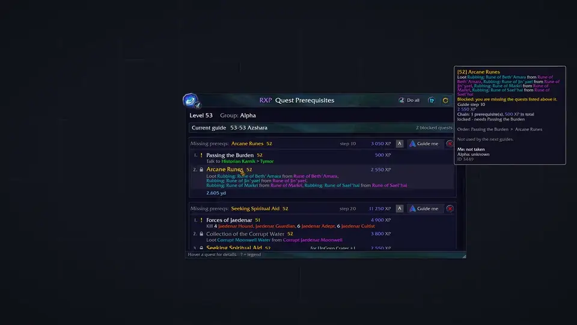</a>

[Watch: Quest Prerequisites, explained (45 s)](videos/quest-prerequisites-explained.mp4) · [Back to the overview](README.md)

Technical design notes for the RestedXP team. Describes the contributor feature as it is in
`Prereq.lua`. The code is the reference; line numbers are approximate.

## 1. Problem

A guide sometimes asks you to accept a quest you cannot get yet, because you skipped part of
its chain. It can also ask you to complete or turn in a quest you don't have. The player usually
learns this at the NPC. This module finds those steps ahead of time, shows the missing chain,
and can generate a temporary RXP guide that does the chain in a travel-optimised order and then
returns you to your original guide.

## 2. User-facing behaviour

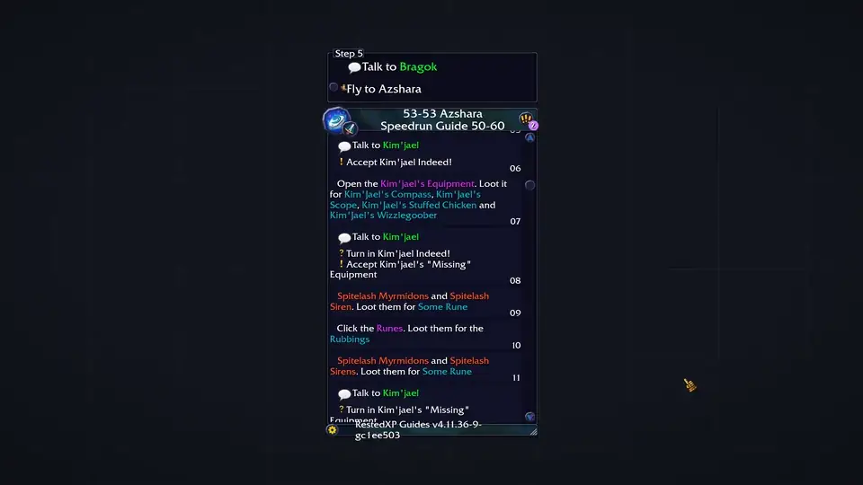

*Opening the window from the banner badge* · [full-quality clip (MP4)](videos/prereq-01-open.mp4)


*What each row shows: lock, XP, what to kill or loot, effort, next guides* · [full-quality clip (MP4)](videos/prereq-03-rows.mp4)


| Entry point | Behaviour (verified in code) |
|---|---|
| `/prereq` | `prereq:Check(true)`: opens the window. Prints a warning if Questie is missing. |
| `/prereq <questId>` | `prereq:Guide(id)`: generates and loads a prerequisite guide for that quest. |
| `/prereq reset` | Clears `RXPPrereqDB.ignored` and the session `offered` set, then refreshes. |
| `/prereq last` (also `dernier`, or the localized `L["last"]`) | Opens `RXPPrereqCopyFrame` with the text of the last generated guide, selected for Ctrl+C. |
| `/prereq resetsize` | Clears `userSized`/`size` and goes back to auto height. |
| Banner icon | `prereq.CreateBannerButton()`: 20x20 button parented to `addon.RXPFrame.GuideName` (top-right corner). Uses the `Textures/v2/rxp-icon-quest_stack` icon and `white_circle` for the badge. The badge shows the number of blocked quests in the current guide (`"9+"` above 9) and is hidden at 0. Click calls `prereq:Toggle()`. The tooltip shows the count. |
| Auto-open | Every 3 s (the ticker starts 8 s after `PLAYER_LOGIN`), `prereq:Check(false)` opens the window when a blocked quest that hasn't been offered this session is within `SOON_STEPS = 3` steps of the current step. In combat it sets `pendingOpen` and opens on `PLAYER_REGEN_ENABLED`. It never auto-opens while the active guide is a generated one. |
| Card "Guide me" | Calls `prereq:Guide(questId)` and hides the window if a guide was started. |
| Card "x" (Ignore) | Sets `RXPPrereqDB.ignored[id] = true` and refreshes. |
| Header "Do all" | Calls `prereq:Guide("all")`: one guide for every blocked chain, merged and ordered together. It is disabled (alpha 0.45, desaturated) when nothing is blocked. The tooltip (`AllSummary`) shows the number of chains, the summed yards and the total XP. It computes at most 6 uncached efforts per hover. |
| Header Refresh / Help / Close | Refresh forces a rebuild and calls `QueryGroup()`. Help shows the legend tooltip. Close hides the window. |
| Escape | `OnKeyDown` with `SetPropagateKeyboardInput`: ESCAPE hides the frame and stops propagation, and every other key propagates. It does **not** use `UISpecialFrames`. The propagation toggle is skipped in combat. |
| Window | `RXPPrereqFrame`, DIALOG strata, movable and resizable (grip). Position and size are saved. Height auto-fits between 220 px and 70 % of the screen unless the user resized it. The skin follows the RXP V1/V2 theme. |

**Card layout** (one card per blocked quest, built in `Render()`):

- Header row (`prereq.CardHeader`): "Asked to do in your guide - missing prerequisites:" (or
  "- not in your quest log:"), then the quest name, a level coloured by difficulty, the chain XP
  total (`~` means estimated), "step N", the move summary (yards / flights / boats), one square
  per group member, and the Guide me and Ignore buttons.
- Numbered rows in execution order (post-order of the tree), with the blocked quest last. Each
  row shows a state icon (available / incomplete / ready / done, or a padlock if that row is
  itself locked), the quest level and XP, and a grey "what to do" line (`prereq.QuestDesc`: kill,
  loot with drop rate and mob, use, go to, talk/deliver, plus the zone when it differs from the
  giver's zone).
- "for <next guide>" label and tooltip section "Needed later (don't skip):": the quest or
  its prerequisites are used by one of the next 3 guides (`BuildFuture`). Otherwise the
  tooltip says "Not used by the next guides.".
- Below the card: an effort line (yards, about N minutes, flights, boats, kill list, loot
  list with drop rates). The tooltip lists up to 5 mobs per item with `~N kills` and XP per
  minute.
- Group status: squares with the initial of each member (up to `MAX_MEMBERS = 4`). The colour
  is the state `n`/`l`/`c`/`t` (not taken / in log / objectives done / turned in). The tooltip
  lists every member.

**Generated guide extras**

- **AH buy steps** (`prereq.AddAHTasks`). The step is optional and is added for an item
  objective when all of these hold:
  - The item is tradeable: `GetItemInfo` classID ~= 12 (quest) and bindType is 0 or 2.
  - The remaining count is known and > 0.
  - Questie has a drop rate for it.
  - The travel time to the nearest friendly auctioneer (`travel.TimeTo`) is shorter than the
    estimated farm time (`count / (rate/100) * 30 s`).

  If Auctionator is loaded, the step is only added when
  `Auctionator.API.v1.GetAuctionPriceByItemID("RXPGuides", id)` returns a price, which is then
  shown. The step uses `.collect item,count,qid` + `.isQuestNotComplete qid` and becomes a
  predecessor of the quest's objectives task.
- **Return to your step**: last task `"return"` = `.goto uiMap,x,y,25` + "Back to your guide: …"
  (+ `.bestroute` if `addon.functions.bestroute` exists, from `AttuneRoute.lua`). Then the
  guide's `#next` loads the original guide again.
- **Re-planning** (`prereq:CheckRoute`): see §3.7.

## Screenshots

Pixel-faithful HTML reproductions of the in-game UI (same layout, sizes, colours and RXP textures, checked side by side against in-game captures on WoW Forever).

The icon on the guide banner shows how many quests of the current guide are blocked.

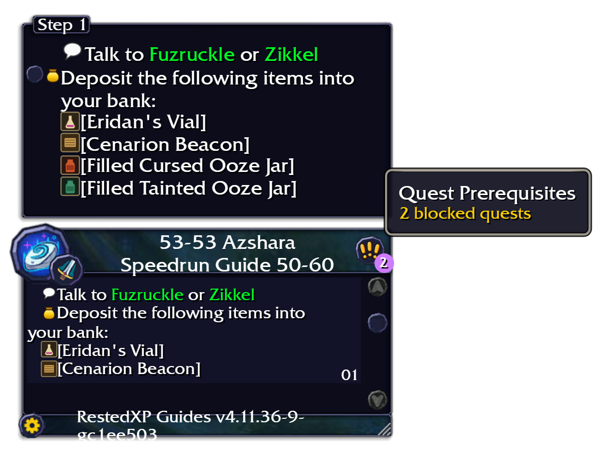

The window lists each blocked quest of the guide with its missing chain, in order: what to kill or loot (with the source), the XP of the chain and its distance. **Guide me** builds a guide for one chain.

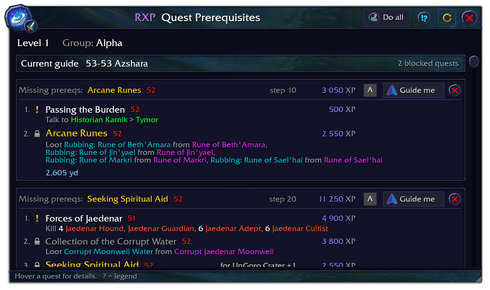

Quests not blocked yet but needed by your **next** guides are flagged too ("Not in your log"), so you can pick them up early.

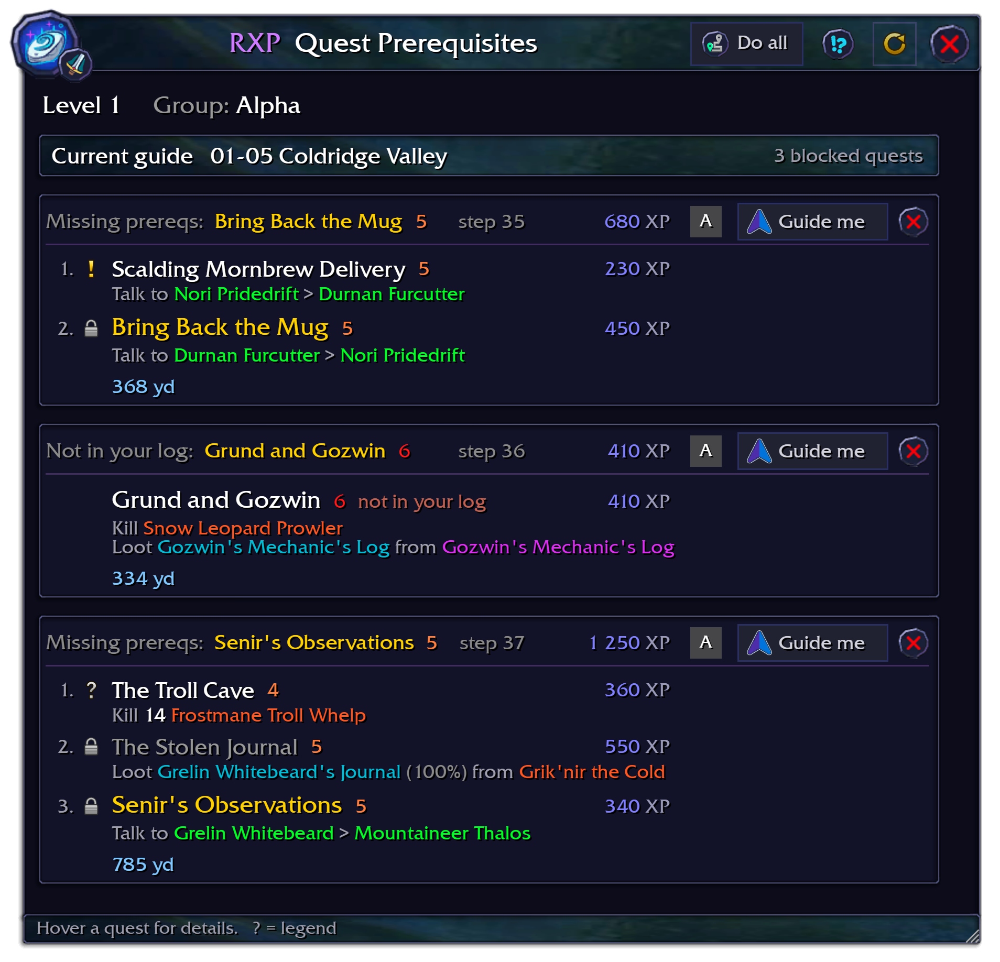

**Do all** builds one guide for every blocked chain, in the shortest order.

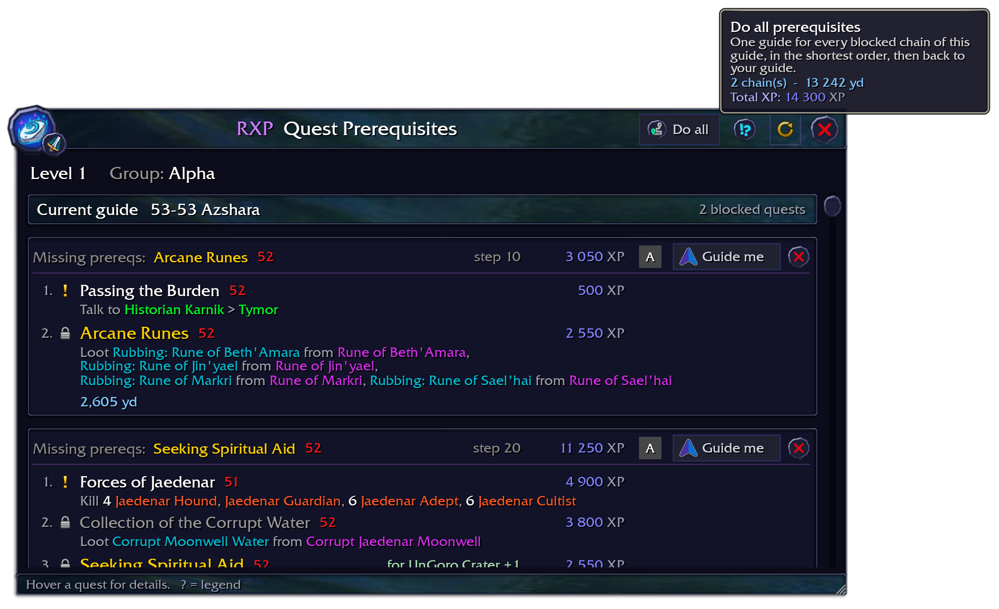

Hovering a quest row shows its details.

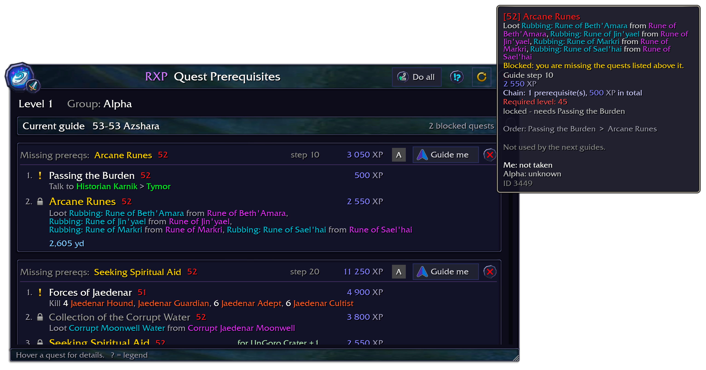

In group mode, each card shows where every member stands on that quest.

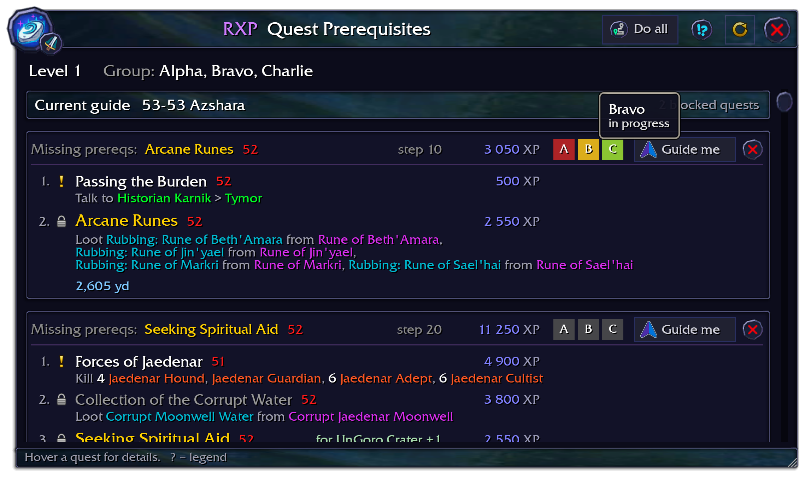

The generated guide includes the travel steps (flight paths to pick up, boats); the RXP arrow follows it.

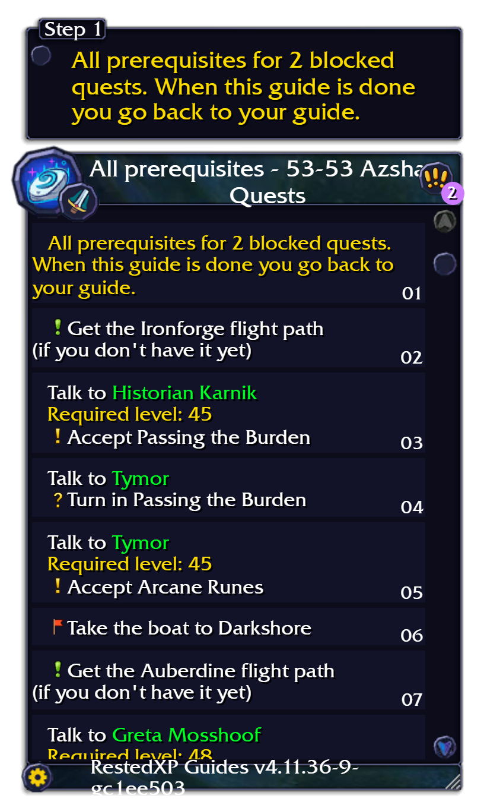

Its last step brings you back to the exact step of your original guide, which then reloads.

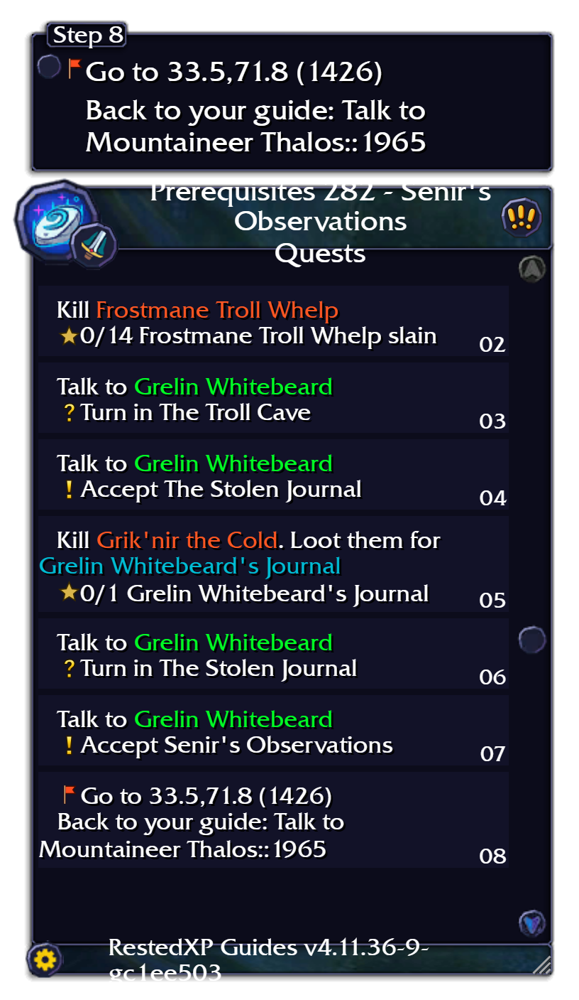

When nothing is blocked.

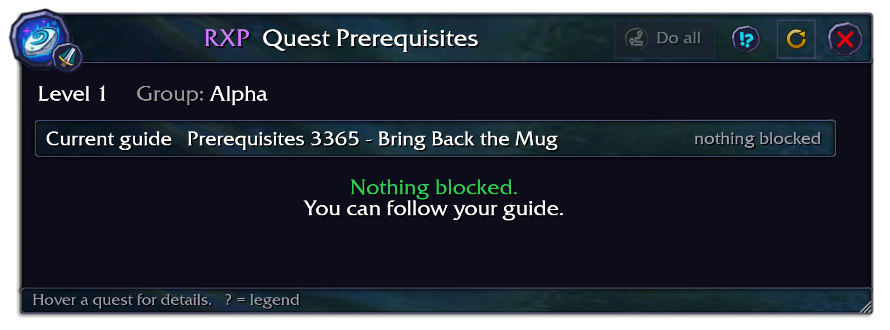

## 3. How it works

### 3.1 Data sources
- **Questie** only, through `addon.questieDB` (set by upstream `functions.lua`).
  - `GetQuest(id)` fields used: `name, Id, level, requiredLevel, requiredRaces,
    requiredClasses, preQuestSingle, preQuestGroup, Starts{NPC,GameObject,Item},
    Finisher{NPC,GameObject}, ObjectiveData{Type,Id,IdList,Text}, objectives, objectivesText,
    triggerEnd`.
  - Other lookups: `GetNPC` (`name, spawns, friendly`), `GetObject`, `GetItem`
    (`npcDrops, objectDrops`), `GetItemDroprate(itemId, npcId) -> {rate, source}`.
  - `QuestieLoader:ImportModule` provides `ZoneDB:GetUiMapIdByAreaId`,
    `QuestXP:GetQuestLogRewardXP` and `Townsfolk.townsfolk["Auctioneer"]`.
- **RXP guide data**: `addon.currentGuide.steps[i].elements[]` (`tag, questId, optional,
  skipIfMissing, textOnly, zone/x/y/radius`), plus `RXPCData.currentStep`, `addon.FetchGuide`,
  `addon.GetGuideTable`, `addon.IsGuideActive`, `addon.affix` and `addon.groupAlias`.
- **Quest state**: `addon.IsQuestTurnedIn / IsOnQuest / IsQuestComplete`, falling back to the
  `C_QuestLog` functions. `C_QuestLog.GetQuestObjectives` gives the remaining counts.
- **Positions**: HereBeDragons-2.0 (`GetPlayerWorldPosition`, `GetWorldCoordinatesFromZone`).
  `NearestSpawn` picks the spawn closest to the player, and spawns on another instance get a
  1e11 penalty.

### 3.2 Detecting blocked quests (`ScanStatic`, `BuildData`)

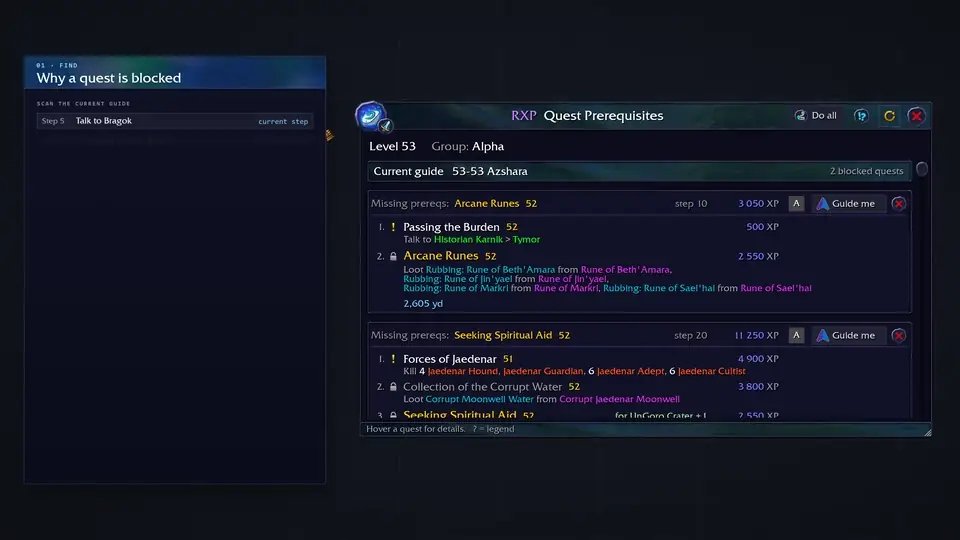

*How blocked quests are found: guide scan, then Questie prerequisite trees (any one / all)* · [full-quality clip (MP4)](videos/prereq-02-find.mp4)

1. `ScanStatic(guide)` is cached per guide table (weak keys). It records `accepts`,
   `turnins` and `needs`:
   - every `.accept` becomes a need of kind `accept`;
   - every `.complete` / `.turnin` becomes a need of kind `missing`, unless the step is
     conditional (`step.optional`, or any element tag starting with `is`) or the element has
     `skipIfMissing`.
2. `Segments()` covers the current guide from `RXPCData.currentStep` plus up to
   `NEXT_GUIDES = 3` guides that follow through `#next`. `ResolveNext` handles `;` lists,
   `group\name`, the `addon.affix` rename and `groupAlias`, and prefers the first active
   guide.
3. Only the **current** guide is scanned for blocked quests. A global position is
   `segment*100000 + step`. A prerequisite counts as satisfied if it is turned in, or if the
   guide turns it in at a position before or equal to this need (`turnPos[p] <= pos`).
4. A need is listed if the quest is Eligible (race and class bitmasks against
   `UnitRace`/`UnitClass` ids), not turned in, not in the log, and not ignored. Beyond that:
   - `accept`: listed when `MissingTree` is not empty;
   - `missing`: listed unless the guide accepts the quest at or before `pos + 3`.

### 3.3 Building the chain
- `DirectMissing(q, Ok)` handles the two Questie prerequisite lists:
  - `preQuestSingle`: any one of them is enough. If none is satisfied, it picks the one in the
    log, otherwise the first Eligible one.
  - `preQuestGroup`: all of them are needed.

  A quest in the log still counts as missing, because its objectives and turn-in are still to
  do.
- `MissingTree(id, Ok)`: DFS, `MAX_DEPTH = 12`. Returns `{id, depth, parent, dup}` and is used
  by the window. `Render()` re-orders it post-order so rows read in execution order.
- `MissingChain(id, assume)`: the same DFS in post-order, de-duplicated, oldest first. It is used
  for generation and effort.
- `AllPrereqs(qid)`: all alternatives, recursive. Used only by `BuildFuture` for the "needed
  later" flag.

### 3.4 Tasks and precedences (`BuildTasks`)
For each chain quest there are three tasks:

- `a<qid>` (accept, skipped if already in the log). It depends on `t<p>` for each direct
  missing prerequisite that is in the chain.
- `c<qid>` (objectives, skipped if the quest has no objectives or they are already complete).
- `t<qid>` (turn-in).

The target gets `a<target>_target`, which depends on every chain turn-in. Its accept step adds
`.isQuestTurnedIn` gates: every `preQuestGroup` id, plus the eligible `preQuestSingle` ids
comma-joined. Each task is `{id, lines, after, uiMap, x, y, kind, questId}`.

"Do all" (`prereq.MergedTasks`) concatenates `BuildTasks` for every target and removes
duplicate ids. It also drops a target task if that quest is already in another chain.

### 3.5 Guide text and registration (`BuildGuideText`, `prereq:Guide`)

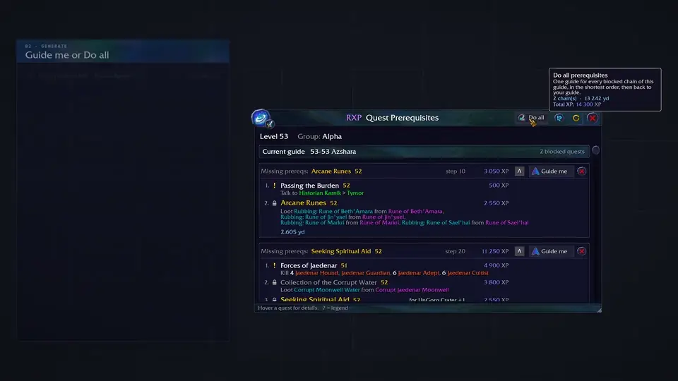

*Guide me (one chain) vs Do all (every chain merged)* · [full-quality clip (MP4)](videos/prereq-04-generate.mp4)

Header:
```
#forever
#version <GetServerTime() % 1e8>
#group RXP Prerequisites (auto)      -- localized: L["RXP Prerequisites (auto)"]
#subgroup Quests
#name Prerequisites <id> - <name>    -- or "All prerequisites - <guide>"
#next <origGroup>\<origName>
step
    +|cRXP_WARN_<intro>|r
```
Step tags emitted:

- `.goto`, `.target Name::npcId`, `.mob Name::npcId`, `.use`, `.accept id >> text`
- `.complete qid,i` (one per objective; if `ObjectiveData` is empty, one per raw objective)
- `.turnin`, `.isQuestTurnedIn`, `.collect`, `.isQuestNotComplete`, `.bestroute`
- travel tags from `Travel.lua` (`.fly`, `.fp`, `.zoneskip`, `.zone`, `.hs`)
- colour tags `|cRXP_FRIENDLY_/ENEMY_/LOOT_/PICK_/WARN_`

`.isOnQuest` is deliberately not used on `.complete` steps (see the comment near
`CompleteLines`).

Ordering: the tasks go to `addon.travel.Plan(tasks)`. The plan is then emitted with a
precedence check: a task whose `after` ids are not all written yet is deferred and flushed as
soon as it becomes ready. Tasks the planner dropped are put back the same way, and a final
loop writes anything left in natural order. The number of deferred tasks is stored in
`prereq.lastRepaired`. For each travel step, `{from, to, target, eta}` is kept in
`prereq.lastTravelSteps[stepNo]` for re-planning.

Registration sequence in `prereq:Guide`:
1. `addon.RegisterGuide(text)`.
2. `addon.SaveGuideProgress(cur, addon.GetGuideProgress(cur))` saves the original guide's
   position.
3. `RXPCData.guideProgress[addon.BuildGuideKey(GROUP,"Quests",name)] = nil`, so the generated
   guide starts at step 1.
4. `RXPPrereqDB.plan` is stored, then `addon:LoadGuideTable(GROUP, guideName)`.

When regenerating from inside a generated guide, `returnTo` is taken from `plan.returnTo`.

### 3.6 Return point (`prereq.ReturnPoint`)

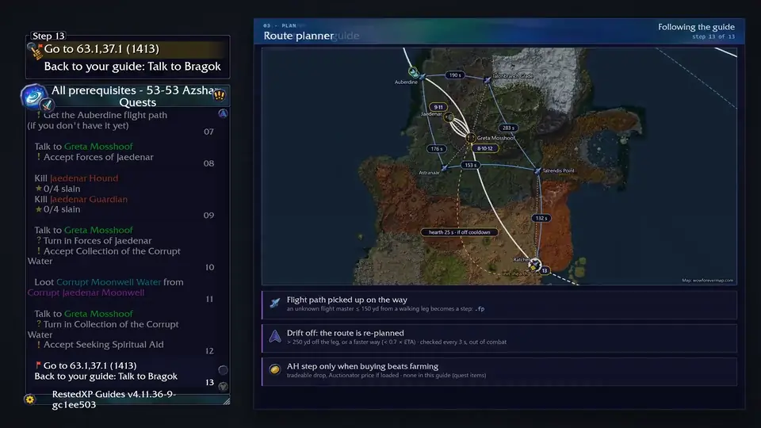

*Back to your exact step in the original guide* · [full-quality clip (MP4)](videos/prereq-07-return.mp4)

1. Start from the saved progress of the original guide and look at up to 40 steps.
2. Skip steps that will already be satisfied, assuming the chain is turned in and the target
   accepted. Only `accept/turnin/complete` count; any other non-text element stops the skip.
3. The return location is the first `.goto` with a radius in that step, otherwise its last
   `.goto`.
4. The label is the first non-goto element text, with colours and textures stripped and cut
   to 60 characters (UTF-8 safe).

### 3.7 Re-planning (`prereq:CheckRoute`)

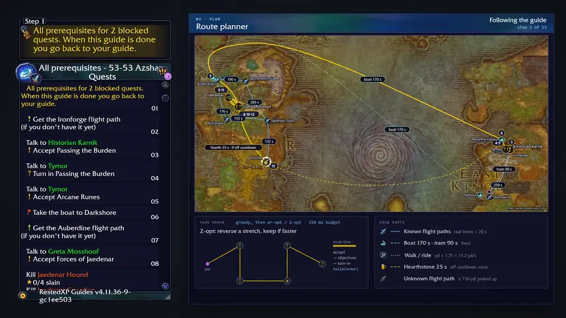

*Following the generated guide: flight path picked up on the way, re-planning when you drift off* · [full-quality clip (MP4)](videos/prereq-06-follow.mp4)

Runs from the 3 s ticker and 2 s after `PLAYER_ENTERING_WORLD` / `ZONE_CHANGED_NEW_AREA`. It
only acts when the active guide is the generated one (`plan.guideName`), the player is out of
combat, and the last re-plan was at least 20 s ago. It re-plans when one of these holds:

- `load`: the guide was just (re)loaded and the plan is more than 120 s old or more than 250 yd
  from the current position;
- `far`: more than 250 yd from the current travel step's `from`, and not at least 50 yd closer
  to its destination;
- `arrived`: within 150 yd of `to` or `target` on a leg longer than 300 yd, but the step did not
  advance;
- `faster`: `travel.WorldTimeFromPlayer(dest)` is under `0.7 * eta`.

A re-plan calls `prereq:Guide(plan.targetId, true)`. For "all", the remaining
`plan.targets` are used.

### 3.8 XP, distance, drop rates
- **XP** (`QuestXP`): uses Questie `QuestXP:GetQuestLogRewardXP(id, false)` when
  `QuestXP.db[id]` exists. A value of 0 below max level is treated as missing. The fallback
  estimate is `base = 2*ql^2 + 30*ql`, `mult = clamp(2*(ql-pl)+20, 1, 10)`,
  `RoundXP(base*mult/10)`, shown with `~`. The cache is per player level.
- **Level colour**: `GetQuestDifficultyColor`. Fallback: classic thresholds with
  `GetQuestGreenRange` or a `GrayLevel` table.
- **Effort** (`prereq.Effort`):
  1. Run `travel.Plan` on the chain tasks.
  2. Walk the plan summing straight-line world yards between task points. Flights and boats
     are counted separately and their distance is not added. A hearth resets the position.
  3. The time is `travel.last.cost`, or `yards / 7` if there is none.
  4. The first leg is recomputed live from the player position (`EffortLine`, `CardMove`).
  5. Kills and loots are aggregated over the chain. Remaining counts come from
     `C_QuestLog.GetQuestObjectives` (matched by name substring), otherwise from the first
     number in Questie `objectivesText`.

  Efforts are cached per card. At most 3 are computed per render and the rest are scheduled
  for the next one. The cache is invalidated after moving 200 yd. Live first-leg text updates
  after 50 yd, checked every 1.5 s.
- **Drop rates**: `GetItemDroprate(item, npc)` keeps the best NPC. When the source is
  `"wowhead"` and the item is a quest item (classID 12) or unknown, the rate is shown with `~`,
  because per-kill rates for quest items are underestimated.

### 3.9 Group status
This uses the hidden addon-message channel from `Duo.lua` (`addon.duo.SendAll / Send / On /
Members`, prefix `RXPDuo`, whisper transport, AceComm when available).

- `PQQ` = comma list of quest ids. It is sent on open, on Refresh, and every
  `QUERY_EVERY = 10` s while the window is open, in chunks of 70.
- `PQR` = `id:state` list, sent in reply and pushed when a state changes (`QUEST_LOG_UPDATE`,
  debounced 2 s; other quest events, 1 s).
- Ids requested by others are watched, up to 1500, then the set resets.

Without `Duo.lua` the window shows "solo (no group status)".

## 4. Integration points with upstream RXP

| Upstream symbol | Use |
|---|---|
| `addon.questieDB` | Questie DB handle (read-only). |
| `addon.currentGuide`, `RXPCData.currentStep`, `RXPCData.guideProgress` | Scan start and progress. Writes one `guideProgress` key directly. |
| `addon.RegisterGuide`, `addon:LoadGuideTable`, `addon.BuildGuideKey`, `addon.SaveGuideProgress`, `addon.GetGuideProgress` | Register and load the generated guide. |
| `addon:FetchGuide`, `addon.GetGuideTable`, `addon.IsGuideActive`, `addon.affix`, `addon.groupAlias` | Resolve `#next` without loading it. |
| `addon.IsOnQuest`, `addon.IsQuestTurnedIn`, `addon.IsQuestComplete` | Quest state. |
| `addon.RXPFrame.GuideName` | Parent of the banner button. |
| `hooksecurefunc(addon, "RenderFrame"/"ReloadTheme")` | Restyle the window and banner badge on theme change. |
| `addon.guideTextColors`, `addon.colors`, `addon.v2` (`IsGuideWindowEnabled`, `GetTheme`, `themes`), `addon.ui.v2:ApplyFrameBackdrop` | Theme colours, fonts, backdrops. |
| `addon.functions.bestroute` (contrib, `AttuneRoute.lua`) | Optional tag on the return step. |
| `addon.travel` (contrib, `Travel.lua`) | Ordering, ETA, AH reachability, player position. |
| `addon.groupL`, `addon.AddGroupTranslations` (contrib) | Strings. |

Events: `PLAYER_LOGIN`, `QUEST_ACCEPTED`, `QUEST_TURNED_IN`, `QUEST_REMOVED`,
`QUEST_LOG_UPDATE`, `PLAYER_LEVEL_UP`, `PLAYER_REGEN_ENABLED`, `PLAYER_ENTERING_WORLD`,
`ZONE_CHANGED_NEW_AREA`. All of them are on a private frame.

**SavedVariablesPerCharacter `RXPPrereqDB`** (declared in `RXPGuides.toc`):
`ignored{qid=true}`, `plan{targetId, guideName, returnTo, made, pos, steps, targets}`,
`lastGuide`, `lastGuideInfo`, `pos{point, relPoint, x, y}`, `size{w,h}`, `userSized`.

**Load order** (end of the toc, after all upstream files): `GroupLocale.lua`,
`GroupTranslations.lua`, `Duo.lua`, `TravelFlightMasters.lua`, `Travel.lua`,
`AttuneRouteData.lua`, `AttuneRoute.lua`, `Prereq.lua`. `Prereq.lua` resolves
`addon.travel` / `addon.duo` at call time, and registers its `Duo` handlers at load time and
again on `PLAYER_LOGIN`.

**Translations**: `Prereq.lua` keeps its own ordered list `K` of English keys and per-locale
arrays `T`. These are zipped into maps and passed to `addon.AddGroupTranslations`. A locale
whose array length differs from `#K` is dropped entirely and falls back to English, so a
missing entry cannot shift every string after it. This is fragile when a key is added in the
middle of the list.

## 5. Known limitations and review items

- **Hard Questie dependency.** Without Questie there is no data: the window shows "Questie is
  required" and generation is refused.
- **Generated guides are tagged `#forever`.** The header is hard-coded, so on other flavours
  the tag (and the `.goto uiMap/inst,x,y` world format used by `Travel.lua`) needs adapting.
- **Localized group name.** `#group` is the localized `L["RXP Prerequisites (auto)"]`, so the
  key changes with the client language. A stored `plan` won't match after a locale switch.
- **Two "satisfied" rules.** The window treats prerequisites the guide itself will turn in
  earlier as satisfied (`turnPos`). `prereq:Guide` builds its chain with `MissingChain(id)`,
  which only counts actually turned-in quests. The generated chain can therefore be longer
  than the card suggests. Decide which rule is intended.
- **`preQuestSingle` choice is heuristic** (the one in the log, otherwise the first eligible),
  not the shortest alternative.
- **Objective counts are matched by name substring** in the objective text, which is
  locale-dependent and ambiguous for similar names.
- **Inconsistent `GetItemInfo` calls (Midnight API).** `Effort` and `QuestDesc` call the global
  `_G.GetItemInfo`, while `AddAHTasks` uses `C_Item.GetItemInfo or GetItemInfo`. On the WoW
  Forever client (interface `16001`, modern Midnight-era API) the global may be absent. The
  `~` flag then defaults to approximate. Make these consistent.
- **Escape handling** depends on `SetPropagateKeyboardInput`, which is skipped in combat. A
  `UISpecialFrames` entry would be simpler.
- **Lua local limit.** `Prereq.lua` has about 186 main-chunk locals, close to Lua's 200 limit.
  This is why later helpers are fields on `prereq` (`prereq.Effort`, `prereq.CardHeader`, …)
  rather than locals. Any refactor should keep it that way or split the file (window / scan /
  generation).
- **Performance.** `BuildData` runs on every guide-step change. Effort runs the full planner
  per card, which the 3-per-render budget and the planner's own 150 ms CPU budget keep in check.
- **Version drift in the base.** `upstream_RXPGuides` differs from the modified tree in many
  upstream files, so most of those diffs are not part of this feature. The one change outside
  the new files that looks like the contributor's is in `GuideLoader.lua` `LoadGuide`: it
  invalidates a `RXPCData.guideDisabled[n]` cache entry when the stored length no longer matches
  the guide.

## 6. File map

| File | Lines | Role |
|---|---|---|
| `Prereq.lua` | 4204 | Scanner, chain builder, guide generator, re-planner, window, banner button, group sync, slash command. |
| `Travel.lua` | 1082 | Task ordering and routing (see `TRAVEL-PLANNER.md`). |
| `TravelFlightMasters.lua` | 69 | `addon.travel.flightMasters` (generated). |
| `Duo.lua` | 1134 | Group transport used for `PQQ`/`PQR` (separate feature). |
| `AttuneRoute.lua` | 1521 | Defines the `.bestroute` tag used on the return step. |
| `GroupLocale.lua` | 19 | `addon.groupL`, `addon.groupLocale`, `addon.AddGroupTranslations`. |
| `GroupTranslations.lua` | 734 | Generated translations for Duo and Travel strings. |
| `RXPGuides.toc` | 125 | Adds `RXPDuoDB, RXPPrereqDB` and the 8 files above. |
