# Community contribution: Quest Prerequisites, travel planner, group mode, attunement guides

Author: Bellucci (WoW Forever player, author of the Deathskip addon).
Base: `RestedXP/RXPGuides` `main`. Built and played on the **WoW Forever** client (Midnight API, interface 16001).

This branch is meant to be **read by the RestedXP dev team**, not merged as is. Every feature is in its own
commit, hooks into existing RXP code are kept to a few lines, and each feature has a design document so you can
judge the idea and reimplement it your own way if you prefer.

> **How this code was written.** I designed the features, wrote the specs, iterated on the UX with players from
> your Discord and tested in game; the Lua was written with an AI coding assistant (Claude) under my direction.
> I know you don't ship AI-written code: that is exactly why the design docs below describe behaviour,
> algorithms and data independently of the implementation. Treat the code as a working reference.

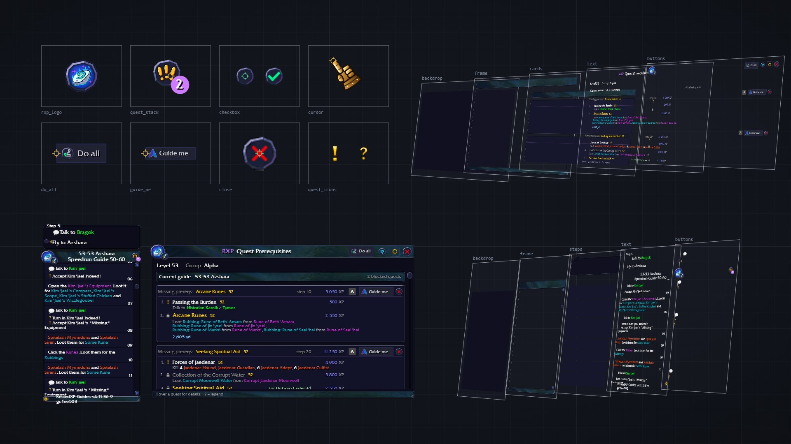

## What players are asking

These features started from questions that come up regularly in the RestedXP Discord. A few recent ones:

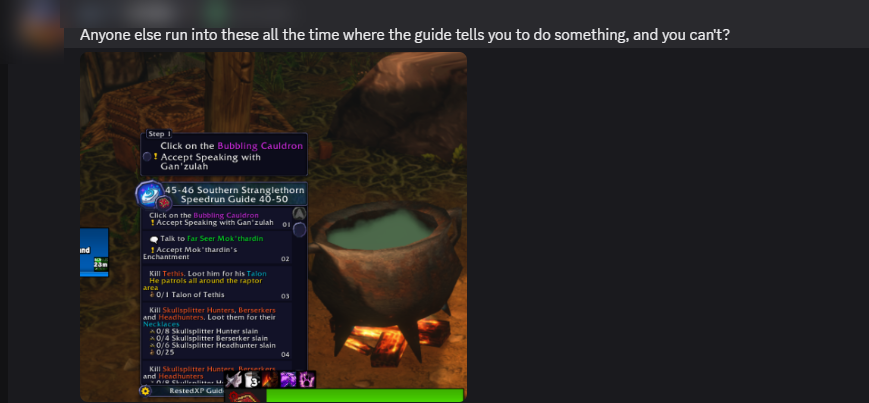

&rarr; **Quest Prerequisites** spots these steps ahead of time, shows the missing chain and builds a routed guide to unlock it, then brings you back to your exact step.

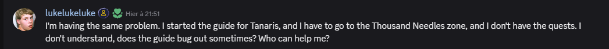

&rarr; Steps for quests that are not in your log are listed too ("not in your quest log"), with what to do to get them, before you travel there.

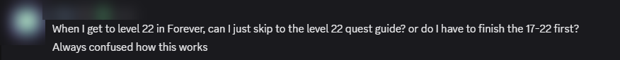

&rarr; The window shows, for the current guide, which quests your **next** guides will need ("for &lt;guide&gt;"), with XP and distance, so you can judge what is worth doing and what you can skip.

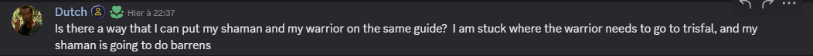

&rarr; **Group mode** maps each friend's current step into your own guide (by step, with a fallback for class-specific steps), so you see where you overlap and who is ahead or behind.

&rarr; The guides stay race-specific as designed, but group mode shows where each friend stands relative to your guide, and the invite and one-click layer change keep the group together.

## What players get

All player-facing texts follow the game language (9 locales, `GroupTranslations.lua`). The videos are rendered from
pixel-faithful HTML reproductions of the in-game UI; the map is the game's painted world map, from wowforevermap.com.

### Quest Prerequisites

Shows every quest of your current guide you can't take yet, with the full missing chain, what to kill or loot, XP and
distance, flags quests your next guides need, and builds a routed guide to unlock them.

<a href="videos/quest-prerequisites-explained.mp4">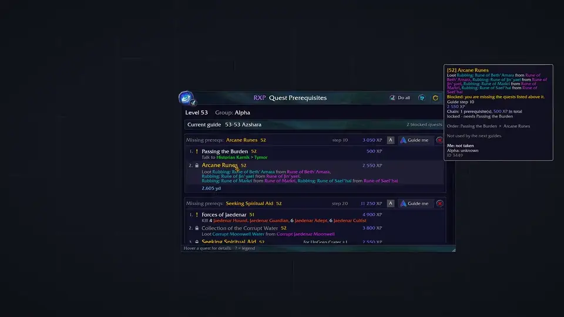</a>

[Watch the explainer (45 s)](videos/quest-prerequisites-explained.mp4) · [Design doc: QUEST-PREREQUISITES.md](QUEST-PREREQUISITES.md)

<a href="QUEST-PREREQUISITES.md#screenshots">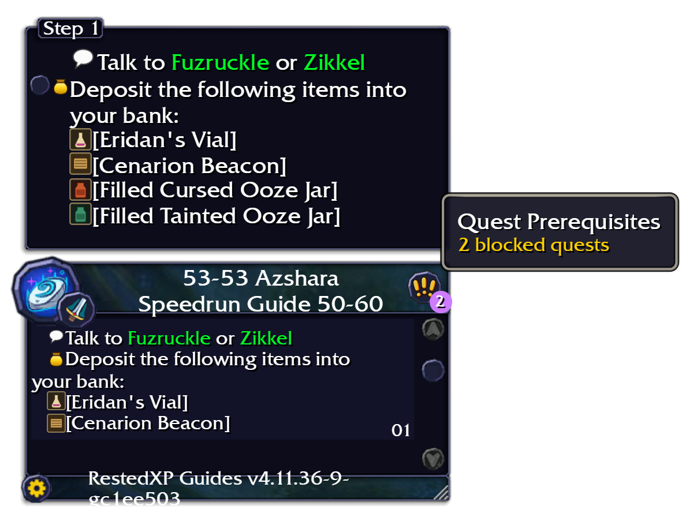</a> <a href="QUEST-PREREQUISITES.md#screenshots">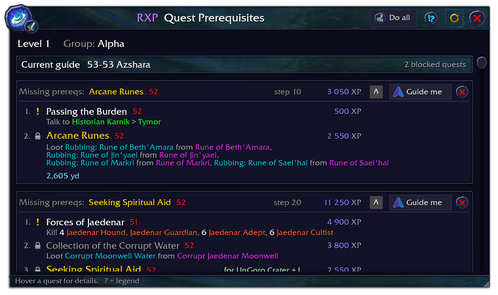</a> <a href="QUEST-PREREQUISITES.md#screenshots">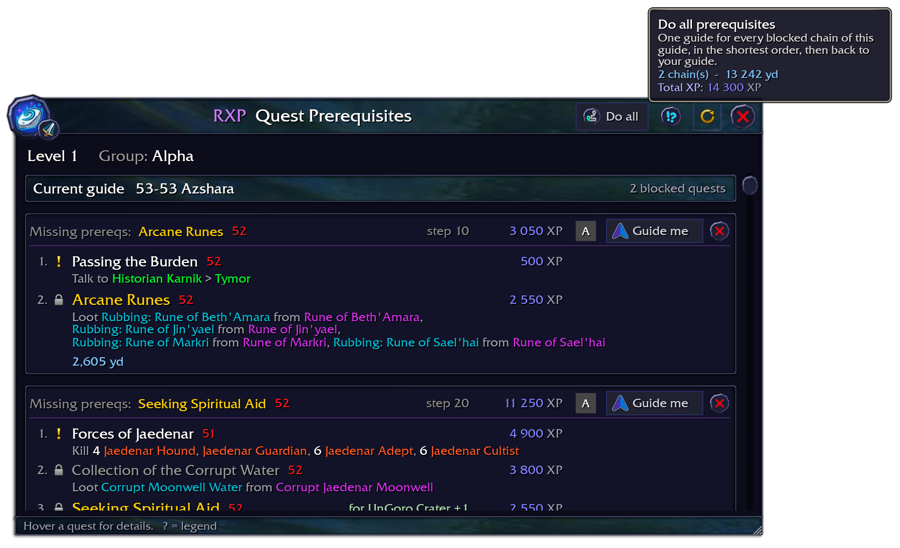</a>

### Travel planner

Fastest route between tasks: your known flight paths with their real flight times, hearthstone only if off cooldown,
boats, zeppelins, tram, walking or riding speed; tasks ordered with prerequisites first, then improved until no shorter
route exists. Re-plans when you drift off and brings you back to your exact step.

<a href="videos/prereq-05-route.mp4">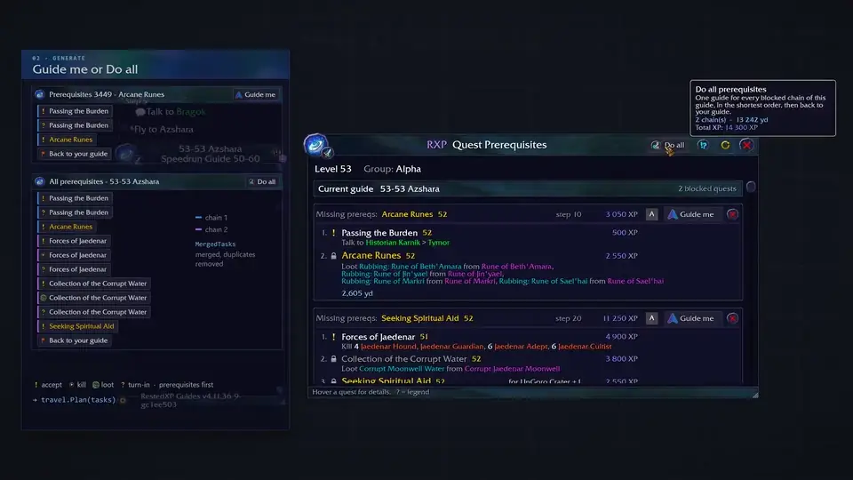</a>

[Watch the route planning (13 s)](videos/prereq-05-route.mp4) · [Design doc: TRAVEL-PLANNER.md](TRAVEL-PLANNER.md)

### Group mode and one-click layer search

Up to 5 players share their guide steps, invite each other from the guide menu, and change layer together in one
click (LayerSwap host search, then automatic regroup on the new layer).

<a href="videos/group-mode-explained.mp4">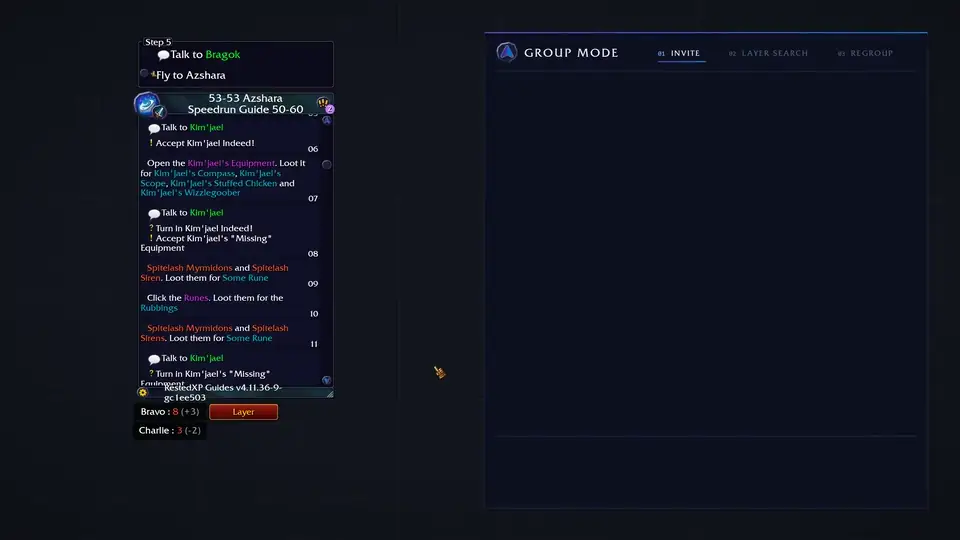</a>

[Watch the explainer (37 s)](videos/group-mode-explained.mp4) · [Design doc: GROUP-MODE.md](GROUP-MODE.md)

<a href="GROUP-MODE.md#24-member-frame">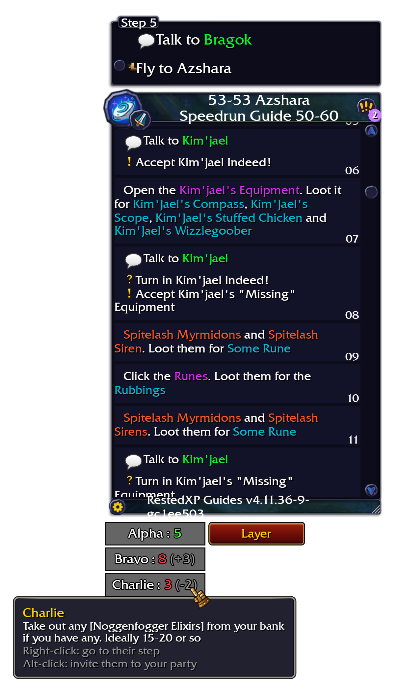</a> <a href="GROUP-MODE.md#23-dialogs">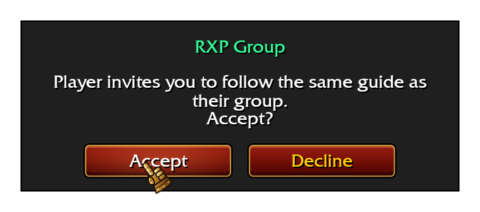</a> <a href="GROUP-MODE.md#25-pulsing-banner">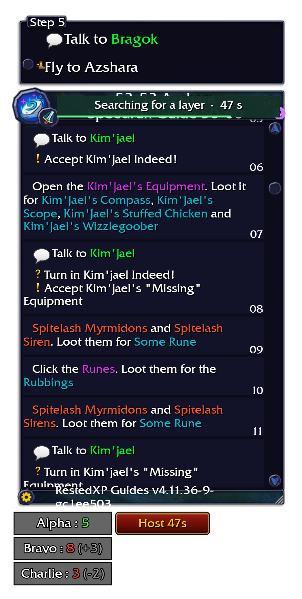</a>

### Attunement guides

16 guides (Scholomance, LBRS, UBRS, Onyxia; Alliance, Horde, rogue-optimised) whose route adapts to your current
quest objectives and uses death skips only at mapped death spots, never right before a fight (data: [Deathskip](#data-behind-the-death-skips-deathskip)).

<a href="videos/attunement-guides-explained.mp4">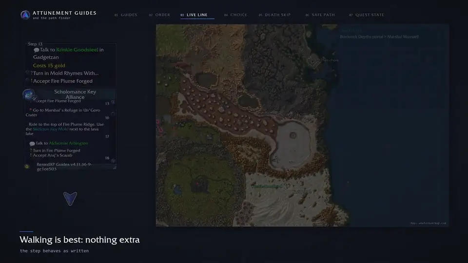</a>

[Watch the explainer (75 s)](videos/attunement-guides-explained.mp4) · [Design doc: ATTUNEMENT-GUIDES.md](ATTUNEMENT-GUIDES.md)

## Commits

| # | Commit | Touches existing RXP code |
|---|---|---|
| 1 | Invalidate a `guideDisabled` entry whose cached length no longer matches | `GuideLoader.lua` (+8 lines) |
| 2 | Guard against a nil step reward in `GetStepQuestReward` | `RXPGuides.lua` (1 line) |
| 3 | Translation layer (`GroupLocale.lua`, `GroupTranslations.lua`) | `.toc` |
| 4 | Travel planner (`Travel.lua`, `TravelFlightMasters.lua`) | `.toc` |
| 5 | Group mode (`Duo.lua`) | `GuideWindow.lua` (menu entry, +4 lines), `.toc` |
| 6 | Quest Prerequisites (`Prereq.lua`) | `.toc` |
| 7 | Attunement guides + route engine (`AttuneRoute*.lua`, `Guides/forever/Attunements-*.lua`) | `GuideList-forever.xml`, `.toc` |
| 8 | This documentation | none |

Commits 1 and 2 are independent bug fixes and can be taken on their own.

## How to try it

1. Check out this branch into `Interface/AddOns/RXPGuides` (WoW Forever client) and restart the game.
2. Open any guide with blocked quests, then click the icon on the guide banner or type `/prereq`.
3. Group mode: the entry in the RXP guide menu, or `/rxpgroup`.
4. Attunement guides: guide list > **Attunement guides** > Alliance / Horde.

## What is tested, what is not

- **Quest Prerequisites + travel planner:** played in game on WoW Forever, iterated with feedback from players
  of your Discord who used the build.
- **Group mode:** used in game by small groups on WoW Forever; layer search depends on Forever's layering behaviour.
- **Attunement guides:** load and route in game; not every guide has been run end to end yet.
- Other clients (Classic Era, TBC, Cata, Retail): **not tested.**
- Code comments are partly in French; the docs are the reference.

## Not included

- A WoW Forever workaround in `Communications.lua` (`ShareQuest` is protected there and raises
  `ADDON_ACTION_BLOCKED`), documented in [ATTUNEMENT-GUIDES.md](ATTUNEMENT-GUIDES.md#related-fixes-and-notes)
  for you to decide.
- A few extra Forever guides I wrote (Alliance Wailing Caverns, Cozy Sleeping Bag, a Night Elf warrior + druid
  duo route): available if you want them.

## Data behind the death skips: Deathskip

The death skips in the attunement guides come from **Deathskip**, my other WoW Forever addon
([CurseForge](https://www.curseforge.com/wow/addons/deathskip), [Discord](https://discord.gg/BKHgxaatxz)). It answers
one question: *if I die right here, which graveyard will I respawn at?* It draws that answer on the world map, and the
attunement route engine reads the same data to decide where a death is worth it.

[Watch the full explainer (90 s)](videos/deathskip-explained.mp4)

<a href="videos/deathskip-01-addon.mp4">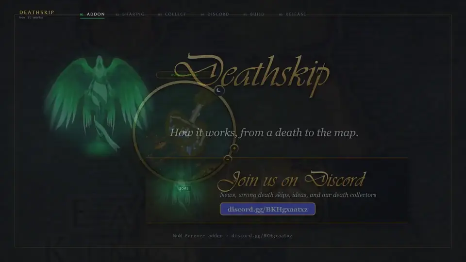</a>

*The addon: minimap button, on-screen box, map options, lines showing where you respawn*

### How the deaths are collected

- Every player running Deathskip records each of their own deaths: where they died, where they respawned, the zone and
  sub-zone, and their faction. No character name is stored or shared.
- The record is sent a few minutes later as a hidden addon message on a faction channel, so other Deathskip users
  (and the collector) receive it.
- A collector character on each faction logs in and asks everyone online for their records; players can also post
  their exports on the Discord, where a bot archives them.
- The archive is merged and de-duplicated on my PC: **18,383 real deaths** so far (17,834 kept after filtering, release 0.4.31).

<a href="videos/deathskip-02-collect.mp4">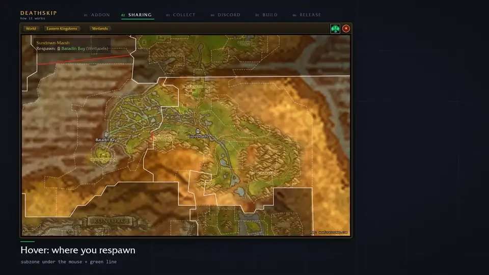</a>

*Players die, the record travels on the hidden channel, the collector gathers them*

<a href="videos/deathskip-03-pipeline.mp4">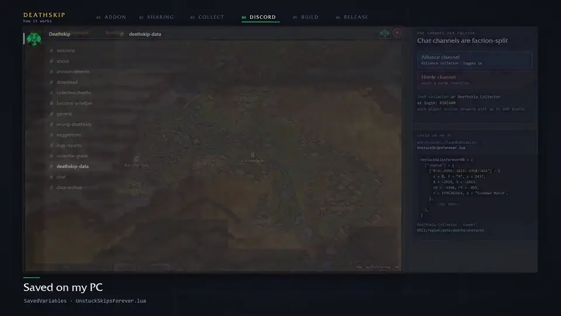</a>

*Exports on Discord, the archive, the stats panel*

### How the rules are built

The game has no API that says which graveyard serves a spot, and WoW Forever moved many of them away from the Classic
table. So the map is rebuilt offline from the real deaths, on the game's own sub-area grid (33 yd cells):

1. **Filters first:** resurrections on the spot, deaths in tunnels or caves that belong to another map, and deaths
   whose position and zone disagree are dropped.
2. **Sub-zone rule:** where players of your faction died in a sub-zone, the graveyard they actually respawned at wins
   (the nearest one if several were seen).
3. **Open zone rule:** elsewhere, candidates are the graveyards linked to the zone in the Classic table plus the ones
   observed there, minus the ones the deaths contradict; the nearest candidate wins.
4. **Guards:** a minority graveyard that the deaths clearly contradict is removed; graveyards only transfer between
   factions when they are neutral; Classic links never seen in the data are dropped; caves and the sea edge are handled
   separately.

<a href="videos/deathskip-04-rules.mp4">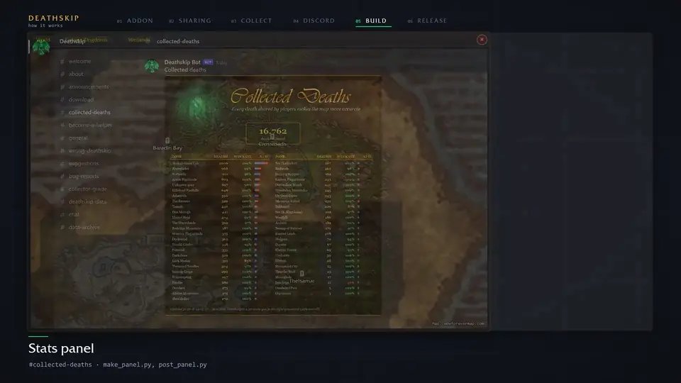</a>

*The rules on the map, with the real Wetlands (Alliance) example and the cross-validation score*

### How it is verified

- **Cross-validation:** the map is rebuilt five times, each time without a fifth of the deaths, and tested on the
  deaths it did not see. Current score: **99.1%** of deaths predicted at the right graveyard.
- **Decoding check:** the shipped data is decoded exactly like the addon does in game and compared with every death.
- **Every new batch is tested before it is added:** deaths that contradict the current map are listed by zone, so a
  real change is distinguished from a bad record.
- **Every release is diffed** against the previous one, and the changed areas are listed per faction in the changelog.
- **Players report** wrong spots in a dedicated Discord channel; those reports and in-game checks close the loop.

Two real examples of what this catches:
- **Wetlands / Thelsamar (Alliance):** a few Wetlands deaths respawned at Thelsamar (Loch Modan). The minority rule now
  rejects that graveyard for the open Wetlands; cross-validation went from 98.9% to 99.2% when it was added.
- **Uldaman back tunnel (0.4.31):** deaths in the tunnel were recorded without a zone and landed on the Loch Modan
  grid, which pulled part of Stonesplinter Valley to the Badlands graveyard. The diff flagged a 411-cell change that no
  Loch Modan death supported; the five tunnel deaths were excluded and Stonesplinter Valley went back to Thelsamar
  (cross-validation 98.8% to 99.1%).

<a href="videos/deathskip-05-release.mp4">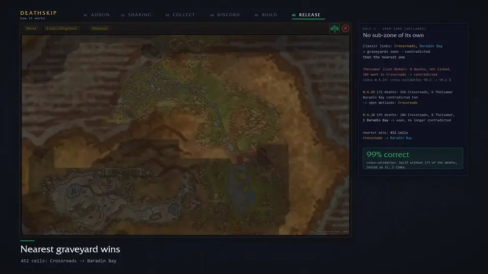</a>

*Release: per-faction diff, changelog, CurseForge upload, patch note, the map updates*

Happy to discuss how this data can be shared with RestedXP.
