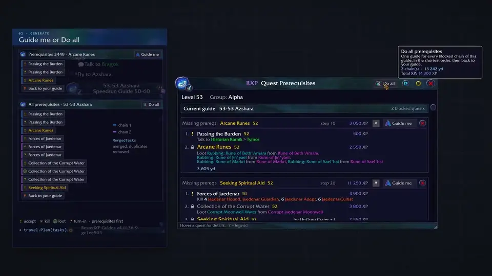
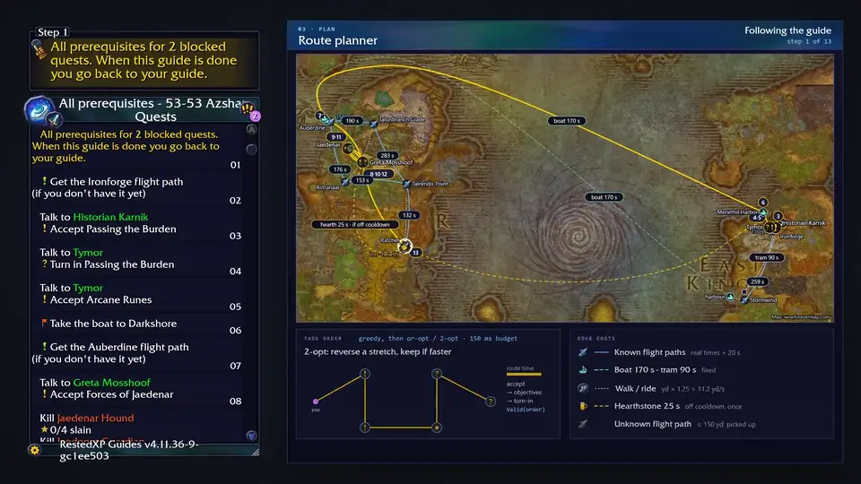

# Travel Planner (`Travel.lua`, `TravelFlightMasters.lua`)

<!-- explained-head -->
<a href="videos/prereq-05-route.mp4"></a>

[Watch: Route planning on the real map (13 s)](videos/prereq-05-route.mp4) · [Back to the overview](README.md)

Technical design notes for the RestedXP team. Describes the contributor feature as it is in
`Travel.lua`. The code is the reference; line numbers are approximate.

## 1. Problem

Generated guides (Quest Prerequisites, Attunement routes) need a sensible order for a set of
tasks spread over a continent, and explicit travel steps between them. Doing tasks in natural
order with straight `.goto` arrows wastes time. It also misses known flight paths, the
hearthstone, and boats, zeppelins and the tram. The planner orders the tasks under precedence
constraints to minimise travel time. It inserts RXP travel steps (`.fly`, `.hs`, `.zone`,
`.fp`) between them.

## 2. User-facing behaviour

There is no UI and no slash command. The planner is a library (`addon.travel`) and the player
only sees its output:

- the steps of a generated guide come out in planned order, not chain order;
- travel steps are inserted between tasks:
  - "Go to the X flight master and fly to Y": `.goto`, `.fly`, `.target`, `.zoneskip`;
  - "Hearth to <inn>": `.hs`, `.use 6948`;
  - "Take the boat / zeppelin / Deeprun Tram to Z": `.goto` dock, `.zone`;
  - "Get the X flight path (if you don't have it yet)": `.goto`, `.fp`, `.target`;
- the window's time estimates (`~N min`) and the AH-vs-farm decision in `Prereq.lua`;
- re-planning while you follow a generated guide (`Prereq.lua` `CheckRoute` uses
  `WorldTimeFromPlayer` and the `from/to/target/eta` fields of each travel entry).

Travel strings go through `addon.groupL` (translated in `GroupTranslations.lua`).

## 3. Public API

Defined on `addon.travel`. `TravelFlightMasters.lua` may create the table first.

```lua
-- tasks: array of { id=any, uiMap=number?, x=0..100?, y=0..100?, after={id,...}?,
--                   duration=seconds? (default CFG.taskTime = 30), ...any other fields kept }
-- returns: ordered array mixing the ORIGINAL task tables and travel entries:
--   { travel=true, kind="fly"|"boat"|"zeppelin"|"tram"|"hearth"|"fp",
--     lines={ "    .goto ...", ... }, text="...", fpId=?,
--     from={wx,wy,inst,uiMap}, to=..., board=..., target=..., eta=seconds }
-- Never throws. On error: travel.lastError = msg, returns a shallow copy of tasks.
addon.travel.Plan(tasks) -> array

addon.travel.TimeTo(uiMap, x, y) -> seconds | nil       -- zone % coords, from the player
addon.travel.WorldTimeFromPlayer(wx, wy, inst) -> seconds | nil   -- HBD world coords
addon.travel.PlayerPos() -> wx, wy, inst | nil          -- HBD:GetPlayerWorldPosition()

addon.travel.config          -- = CFG (tunable, read by AttuneRoute.lua)
addon.travel.last            -- after Plan: { cost, hearthLeg, tasks, pickups={shortName...} }
addon.travel.lastError       -- last DoPlan error
addon.travel.flightMasters   -- [taxiNodeId] = { id=npcId, name=... } (TravelFlightMasters.lua)
```

Tasks without a position (no `uiMap/x/y`, or HBD cannot convert) are still ordered, but they
add only `duration` and do not move the current position. `travel.last` is module-global
state. `AttuneRoute.lua` `PlanTo` saves and restores it around its own calls, and
`Prereq.lua` reads `travel.last.cost` right after `Plan`.

## 4. How it works


*Route planning on the real map: you are here, next objective, travel graph, Dijkstra, ordering, guide built leg by leg* · [full-quality clip (MP4)](videos/prereq-05-route.mp4)


### 4.1 Coordinates
All routing uses HereBeDragons-2.0 world coordinates `{wx, wy, inst}` (instance 0 = Eastern
Kingdoms, 1 = Kalimdor). `ZonePoint(uiMap, x, y)` converts zone percentages, and
`ParseWorld("map/inst,wx,wy")` parses the literal format used by Forever guides. Output
`.goto` lines use the same `uiMap/inst,wx,wy` world format (`WorldGoto`). The map is
chosen as the first of the node's maps where HBD can project the point, otherwise
`CONTINENT_MAP = {[0]=1415, [1]=1414}`.

### 4.2 Static data
- `CFG` (seconds or yards per second):

  | Setting | Value |
  |---|---|
  | `walk` | 7.0 |
  | `mount60` | 11.2 |
  | `mount100` | 14.0 |
  | `detour` | 1.25 (multiplier on straight-line walking) |
  | `flyOverhead` | 20 |
  | `flySpeed` | 30 (fallback) |
  | `flyDetour` | 1.2 |
  | `hearth` | 25 |
  | `boat` | 170 |
  | `zeppelin` | 170 |
  | `tram` | 90 |
  | `taskTime` | 30 |
  | `budgetMs` | 150 |
  | `fpRadius` | 150 yd |
  | `fpPickup` | 10 |
  | `fpMaxRoutable` | 3 |

- `TRANSPORTS`: 10 bidirectional links, each tagged with a faction or neutral.
  - Alliance boats: Menethil-Theramore, Menethil-Darkshore, Menethil-Southshore (Forever),
    Stormwind-Darkshore (Forever), Darkshore-Rut'theran.
  - Neutral boat: Ratchet-Booty Bay.
  - Horde zeppelins: Durotar-Tirisfal, Durotar-Grom'gol, Tirisfal-Grom'gol.
  - Alliance tram: Stormwind-Ironforge.

  Each endpoint has `g` (world point), `zone` (arrival uiMap for `.zone`) and `name`. A crossing
  costs the fixed `CFG[kind]`; there is no schedule.
- `INNS`: about 50 `GetBindLocation()` names (lower-case) mapped to a world-point string or an
  approximate `{uiMap, x%, y%}`. It includes Forever-only places (`powderfuse port`,
  `farholde keep` on map 2548, `shen'dar village` / `valanaar` on 2521). `INN_ALIASES` and a
  substring match handle variants.
- Flight paths come from upstream DB tables:
  - `addon.FPDB[faction][nodeId]`: `name` and direct flight times `[otherNode] = seconds`;
  - `addon.taxiPos[inst][nodeId]`: `{wx, wy, flag}`. These are `UnitPosition` order, so `x` and
    `y` are swapped on read;
  - `addon.FPbyZone[faction]`: `uiMap -> node`, inverted into each node's `maps`;
  - `RXPCData.flightPaths[nodeId]`: which nodes are known.

  The faction filter uses the `flag` bit (1 = Alliance, 2 = Horde).
- `TravelFlightMasters.lua` is generated by `ext/attunements/scripts/gen_flightmasters.py`
  (do not edit). It maps 63 taxi nodes to the Questie Forever flight-master `{id, name}`, used
  for `.target Name::id` lines.

### 4.3 Speeds and hearthstone
- `GroundSpeed()`:
  - 14.0 if any 100 % riding spell (33391, 34090, 34091, 90265) is known;
  - 11.2 if 33388 is known or the player is level 40 or higher (Classic assumption);
  - otherwise 7.0.
- `HearthInfo()`: item 6948 count (`C_Item.GetItemCount` or `GetItemCount`), the bind point
  through `InnPoint(GetBindLocation())`, and `readyIn` from `C_Container.GetItemCooldown` or
  `GetItemCooldown`. It returns nil when there is no stone or the inn is unknown.

### 4.4 Graph (`BuildGraph(points, all, extra)`)
- **Nodes**: the task points `1..n`, then the usable flight masters, then two dock nodes per
  transport allowed for the player's faction.
- **Walk edges**: every pair on the same `inst`, cost `dist * detour / speed`. The matrix is
  dense, O(V²) per graph.
- **Flight edges**: `FlightSubset` keeps the known nodes plus the `extra` ones (nodes being
  learned during this plan) and builds direct times from `FPDB` in either direction.
  - A node with no FPDB data on the same continent gets an estimate of
    `dist * flyDetour / flySpeed`.
  - Floyd-Warshall turns this into all-pairs times over the usable nodes only, because the game
    chains flights through known nodes automatically.
  - Every flight costs `+flyOverhead`.
- **Transport edges**: `links` on the dock nodes, cost `CFG[kind]`.

### 4.5 Shortest paths (`Dijkstra(G, src)`)
- A simple O(V²) Dijkstra without a heap, from an arbitrary world point.
- Initial distances are walking costs to every node on the same continent. Then it relaxes
  walk, fly (for `fp` nodes) and transport edges.
- It returns `dist`, `pred` (0 = source), `mode` (`walk|fly|transport`) and `link`, and
  `PathEdges` rebuilds the edge list.
- Cross-continent travel is only possible through a transport, a flight or the hearthstone.

### 4.6 Unknown flight paths picked up on the way



*Following the generated guide: flight path picked up on the way, re-planning when you drift off* · [full-quality clip (MP4)](videos/prereq-06-follow.mp4)

- `unknown` holds the faction's flight masters missing from `RXPCData.flightPaths`.
- **Candidates**: unknown nodes within `fpRadius` (150 yd) of any segment between the start
  and the task points (`SegDist`), sorted by distance.
- Only the closest `fpMaxRoutable` candidates (3, or 1 when there are more than 25 tasks) are
  `routable`: once crossed, they are added to the flight graph for the rest of the plan.
- **States**: each set of learned nodes is a state with its own graph. States are memoised by
  their sorted id signature, with lazy Dijkstra per source and a leg cache.
- **Pickup cost**: any unknown node within 150 yd of a walking edge of a leg (`WalkPickups`,
  sorted along the edge) adds `fpPickup + 2 * d * k` the first time. It is emitted as an `fp`
  travel entry before the leg continues.

### 4.7 Ordering (`DoPlan`)
1. **Precedences**: `preds[i]` holds the task indexes from `tasks[i].after`. Unknown ids are
   ignored.
2. **`Eval(order)`** simulates the order:
   - it adds each leg cost and each task `duration`, and updates the learned-flight state as
     pickups happen;
   - **hearthstone**: for each leg reached once `elapsed >= hs.readyIn`, it computes the saving
     `legCost - (CFG.hearth + cost(inn -> task))`. The single best saving is subtracted, so at
     most one hearth per plan, used where it helps most once the cooldown is up;
   - it returns `(cost, hearthLegIndex)`.
3. **`Greedy()`**: nearest available task (all predecessors placed) by leg cost under the
   current state. If there is a cycle, it takes the first unplaced task.
4. **`Improve(order)`**: local search with first-improvement and a 0.5 s threshold. It stops
   after 30 passes or when `CFG.budgetMs` (150 ms of `debugprofilestop`) is spent.
   - **Or-opt**: move a segment of length 1 to 3 to every other position.
   - **2-opt**: reverse sub-ranges `[i..j]`, tried only when or-opt found nothing in that pass.
   - Every candidate must pass `Valid(order)` (precedences respected).
5. `Improve(Greedy())` runs first. If time remains and the given order is valid,
   `Improve(given)` also runs, and the cheaper of the two is kept.
6. **Output pass**: replays the final order with a fresh state.
   - At `hsK` it emits `HearthEntry` and routes the leg from the `"inn"` source.
   - For each edge of the leg it emits `FpEntry` for walking pickups, `FlyEntry` for `fly`
     edges (one `.fly` to the final node of a multi-hop chain) and `TransportEntry` for
     transport edges, then the task table itself.
   - `Tag()` sets `from` (end of the previous entry), `to`, `board` (flight master or dock),
     `target` (task point) and `eta` (seconds from `from` to the target).
   - It sets `travel.last = {cost, hearthLeg, tasks, pickups}`.

### 4.8 Travel entry lines
- `FlyEntry`:
  - `.goto <fm>`;
  - `.fly <flyName> >>text`, where `flyName` is the shortest unambiguous prefix of the FPDB name
    (the part before the comma, if no other node's name contains it), because RXP matches a
    substring;
  - `.target Name::id`;
  - `.zoneskip m1/m2` with the destination node's maps, only when they don't overlap the origin's
    maps. If FPbyZone has no maps, `C_Map.GetMapInfoAtPosition` on the continent supplies
    them.
- `TransportEntry`: `.goto <dock g>`, `.zone <arrival uiMap> >>text`.
- `HearthEntry`: `.hs >>text`, `.use 6948`.
- `FpEntry`: `.goto`, `.fp <flyName> >>text`, `.target`. RXP completes the step on its own if
  the path is already known.

### 4.9 Single-target estimates (`TimeFromPlayer`)
`TimeTo`, `WorldTimeFromPlayer`: build a graph with one point and run Dijkstra from the player.
If the hearthstone is ready now (`readyIn <= 0`), they also try `hearth + inn -> point` and keep
the minimum. The result is nil if the point is unreachable (cost >= `INF = 1e7`). Unknown flight
paths are not considered here.

## 5. Integration points

| Symbol | Origin | Use |
|---|---|---|
| `addon.FPDB`, `addon.taxiPos`, `addon.FPbyZone` | upstream `DB/<flavour>/` | Flight network and positions. |
| `RXPCData.flightPaths` | upstream (filled by `functions.lua` / `Timers.lua`) | Known nodes. |
| `addon.groupL` | contrib `GroupLocale.lua` | Travel strings. |
| HereBeDragons-2.0 (LibStub) | embedded lib | Coordinates and player position. |
| `C_Map.GetBestMapForUnit`, `C_Map.GetMapInfoAtPosition` | game API | Start map, node zone lookup. |
| `IsPlayerSpell`/`IsSpellKnown`, `UnitLevel`, `UnitFactionGroup`, `GetBindLocation`, `C_Item.GetItemCount`, `C_Container.GetItemCooldown`, `debugprofilestop` | game API | Speed, faction, hearth, CPU budget. |

The planner writes nothing to SavedVariables and hooks no upstream function. Its consumers are
`Prereq.lua` (`Plan`, `TimeTo`, `WorldTimeFromPlayer`, `PlayerPos`, `last`) and `AttuneRoute.lua`
(`Plan`, `config`, `flightMasters`, `last`). In the toc it loads after `TravelFlightMasters.lua`
and before `AttuneRouteData.lua` / `AttuneRoute.lua` / `Prereq.lua`. `Travel.lua` does
`addon.travel = addon.travel or {}` so it keeps the `flightMasters` table created by the earlier
file.

## 6. Known limitations and review items

- **Forever-specific data.** The transports, inns (maps 2521 and 2548, the Southshore and
  Stormwind-Darkshore boats) and flight masters are hand-tuned for the WoW Forever client
  (`camelot` load type, interface `16001`). Some coordinates are approximate: the Rut'theran dock
  is the flight-master position, and inns given as zone percentages are rough. Other flavours
  would need their own tables. `CONTINENT_MAP` only covers instances 0 and 1.
- **Fixed transport cost.** Boats and zeppelins use a constant average (170 s) with no schedule
  and no faction-neutral ports beyond Ratchet-Booty Bay. There is no Outland or Northrend.
- **Mount heuristic.** Level 40 or higher is treated as having a 60 % mount even without the
  spell, and there are no speed bonuses.
- **Walking cost.** It is straight-line distance times 1.25 on the same continent. It ignores
  terrain, water, mountains and hostile areas, which can give unrealistic legs.
- **Hearthstone.** At most one hearth per plan. The cooldown is compared with the simulated
  elapsed time, not real time spent on each task.
- **Complexity.** Each state graph is O(V²) memory plus O(F³) for Floyd-Warshall over known
  flight paths. Dijkstra is O(V²) per source and there are up to `2^fpMaxRoutable` states. This is
  bounded by the 150 ms budget, but a large task list (more than 25) still pays the full greedy
  pass before the budget check.
- **Shared state.** `travel.last` is shared module state, so callers must read it right after
  `Plan` or save and restore it.
- **Midnight-era API.** API calls prefer `C_Item` / `C_Container` with global fallbacks.
  `HBD:GetPlayerWorldPosition()` returns nil in instances, in which case `Plan` returns the
  tasks unchanged.
- **Output coupling.** The emitted `.goto uiMap/inst,wx,wy` world format and `.fly`/`.fp` name
  matching depend on how RXP parses these tags on the Forever client. Check this if the planner
  is reused elsewhere.

## 7. File map

| File | Lines | Content |
|---|---|---|
| `Travel.lua` | 1082 | `CFG`, `TRANSPORTS`, `INNS`, flight subset + Floyd-Warshall, graph, Dijkstra, FP pickups, greedy + or-opt + 2-opt, entry builders, public API. |
| `TravelFlightMasters.lua` | 69 | Generated `addon.travel.flightMasters` (63 nodes). |
| `GroupLocale.lua` | 19 | `addon.groupL` (English-key fallback) and `addon.AddGroupTranslations(t)`. |
| `GroupTranslations.lua` | 734 | Generated by `tools/make_group_translations.py`. Translations for Duo and Travel strings. |
